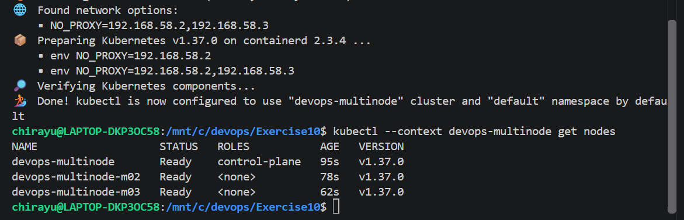
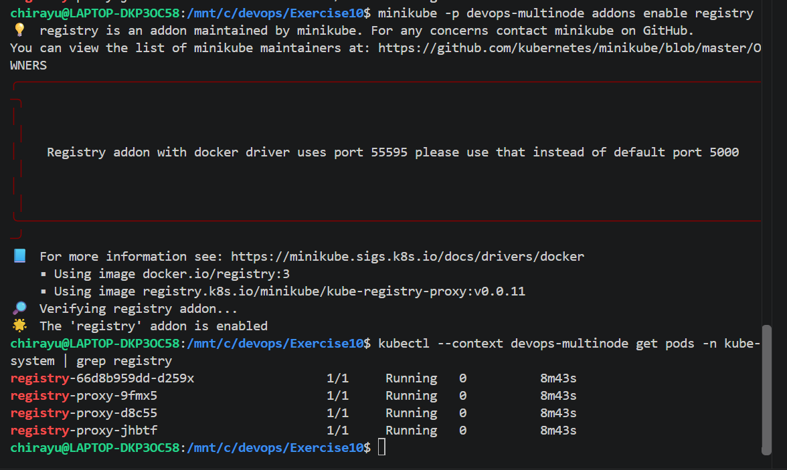
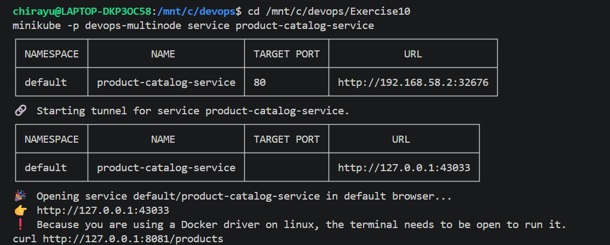
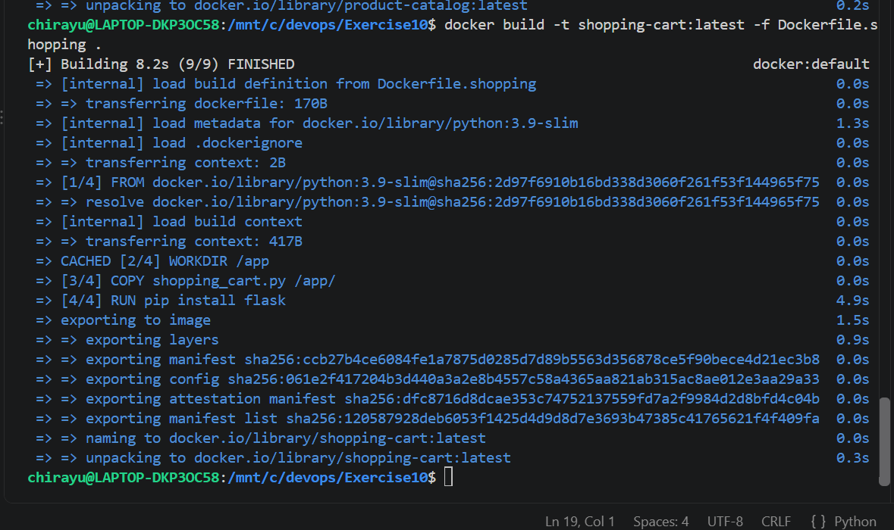
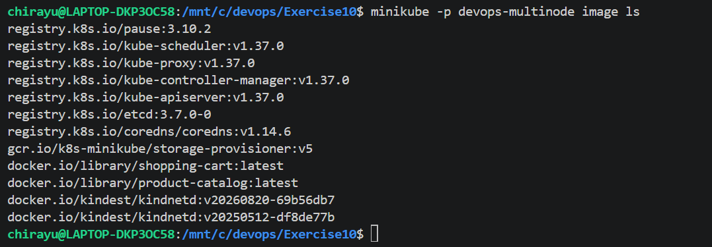
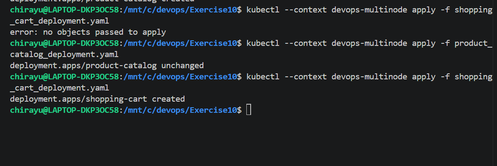
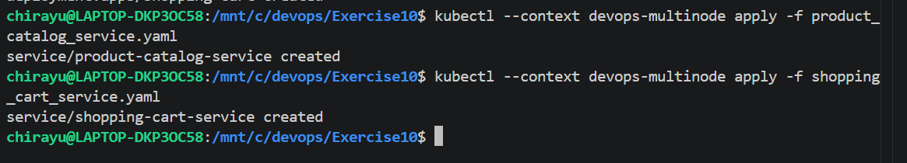
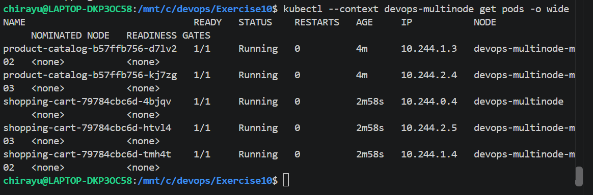
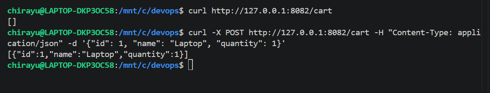

# Exercise 10: Multi-Node Kubernetes Cluster with Multiple Applications and ReplicaSets

## Objective

Deploy two Flask applications on a three-node Minikube Kubernetes cluster. The Product Catalog application provides product information, while the Shopping Cart application manages cart operations. Product Catalog runs two replicas, and Shopping Cart runs three replicas. Pod anti-affinity rules ensure that replicas of the same application are distributed across different nodes, improving availability and fault tolerance.

## Storyboard

The exercise simulates an e-commerce platform containing two independent services:

- **Product Catalog (AppA):** Provides information about available products.
- **Shopping Cart (AppB):** Allows users to view their cart and add products.

The applications are containerized using Docker and deployed on a three-node Kubernetes cluster. Kubernetes Deployments manage the application replicas, while NodePort Services expose the applications for testing.

## Use Case

An online store requires high availability for product browsing and shopping cart operations. Running multiple replicas across separate nodes helps ensure that a single node failure does not bring down an entire application. Kubernetes pod anti-affinity is used to distribute replicas across the cluster.

---

## Step 1: Create a Three-Node Minikube Cluster

A separate Minikube profile named `devops-multinode` was created to run a three-node Kubernetes cluster.

```bash
minikube start --nodes 3 -p devops-multinode --driver=docker
```

The cluster nodes were verified using:

```bash
kubectl --context devops-multinode get nodes
```

All three nodes reached the `Ready` state, confirming that the cluster was ready for application deployment.



## Step 2: Enable the Registry Addon

The Minikube registry addon was enabled using:

```bash
minikube -p devops-multinode addons enable registry
```

The registry-related pods were checked using:

```bash
kubectl --context devops-multinode get pods -n kube-system | grep registry
```

The registry addon was enabled, and the registry components were checked before proceeding.



## Step 3: Develop the Product Catalog Application

The Product Catalog application was implemented using Flask in `product_catalog.py`. It maintains a list of three products and provides a GET endpoint at `/products`.

```python
from flask import Flask, jsonify

app = Flask(__name__)

products = [
    {"id": 1, "name": "Laptop", "price": 1200},
    {"id": 2, "name": "Phone", "price": 800},
    {"id": 3, "name": "Headphones", "price": 150},
]

@app.route("/products", methods=["GET"])
def get_products():
    return jsonify(products)

if __name__ == "__main__":
    app.run(host="0.0.0.0", port=80)
```

The application returns the product list in JSON format when the `/products` endpoint is requested.



## Step 4: Develop the Shopping Cart Application

The Shopping Cart application was implemented in `shopping_cart.py` using Flask. It supports retrieving the current cart through a GET request and adding an item through a POST request at `/cart`.

```python
from flask import Flask, jsonify, request

app = Flask(__name__)

cart = []

@app.route("/cart", methods=["GET"])
def get_cart():
    return jsonify(cart)

@app.route("/cart", methods=["POST"])
def add_to_cart():
    item = request.json
    cart.append(item)
    return jsonify(cart), 201

if __name__ == "__main__":
    app.run(host="0.0.0.0", port=80)
```

The cart initially returns an empty list. When an item is submitted through a POST request, the application adds it to the cart and returns the updated list.

## Step 5: Containerize Both Applications

Two Dockerfiles were created to package the Flask applications into separate Docker images.

**Dockerfile.product**

```dockerfile
FROM python:3.9-slim
WORKDIR /app
COPY product_catalog.py /app/
RUN pip install flask
CMD ["python", "product_catalog.py"]
```

**Dockerfile.shopping**

```dockerfile
FROM python:3.9-slim
WORKDIR /app
COPY shopping_cart.py /app/
RUN pip install flask
CMD ["python", "shopping_cart.py"]
```

The Docker images were built using:

```bash
docker build -t product-catalog:latest -f Dockerfile.product .
docker build -t shopping-cart:latest -f Dockerfile.shopping .
```

The first image contains the Product Catalog application, and the second contains the Shopping Cart application.



## Step 6: Load Docker Images into Minikube

Both locally built images were loaded into the `devops-multinode` cluster:

```bash
minikube -p devops-multinode image load product-catalog:latest
minikube -p devops-multinode image load shopping-cart:latest
```

The available images were verified using:

```bash
minikube -p devops-multinode image ls
```

Both `product-catalog:latest` and `shopping-cart:latest` were present in the cluster, allowing Kubernetes to run the applications using the locally built images.



## Step 7: Deploy Applications with Pod Anti-Affinity

Two Kubernetes Deployment manifests were created:

- `product_catalog_deployment.yaml`
- `shopping_cart_deployment.yaml`

The Product Catalog Deployment was configured with two replicas, while the Shopping Cart Deployment was configured with three replicas.

Both Deployments use the `requiredDuringSchedulingIgnoredDuringExecution` pod anti-affinity rule with the topology key `kubernetes.io/hostname`. This hard scheduling constraint prevents replicas of the same application from being placed on the same node.

The Deployment manifests were applied using:

```bash
kubectl --context devops-multinode apply -f product_catalog_deployment.yaml
kubectl --context devops-multinode apply -f shopping_cart_deployment.yaml
```

Kubernetes created the Deployments and managed their ReplicaSets to maintain the desired number of application pods.



## Step 8: Expose Both Applications Using Services

Two NodePort Service manifests were created:

- `product_catalog_service.yaml`
- `shopping_cart_service.yaml`

The Services expose the applications on port 80 and route incoming requests to the corresponding application pods.

The Services were created using:

```bash
kubectl --context devops-multinode apply -f product_catalog_service.yaml
kubectl --context devops-multinode apply -f shopping_cart_service.yaml
```

The successful creation of both Services confirmed that the applications had Kubernetes networking resources for accessing their endpoints.



## Step 9: Verify Pod Distribution Across Nodes

The status and node placement of all application pods were verified using:

```bash
kubectl --context devops-multinode get pods -o wide
```

The results showed that all five pods were in the `Running` state and were ready to serve requests.

The Product Catalog had two replicas distributed across two different nodes. The Shopping Cart had three replicas distributed across all three nodes. No two replicas of the same application shared a node, confirming that the pod anti-affinity rules worked as intended.



## Step 10: Access and Test Both Applications

The applications were exposed using Minikube Service commands:

```bash
minikube -p devops-multinode service shopping-cart-service
```

```bash
minikube -p devops-multinode service product-catalog-service
```

Minikube provided local tunnel URLs for accessing the Services. The tunnel terminals were kept running while the API requests were tested.

### Test the Product Catalog

The `/products` endpoint was tested using `curl`:

```bash
curl http://127.0.0.1:<product-catalog-port>/products
```

The response contained the three configured products:

```json
[
  {"id": 1, "name": "Laptop", "price": 1200},
  {"id": 2, "name": "Phone", "price": 800},
  {"id": 3, "name": "Headphones", "price": 150}
]
```

### Test the Shopping Cart

The initial cart was retrieved using:

```bash
curl http://127.0.0.1:<shopping-cart-port>/cart
```

The initial response was:

```json
[]
```

A Laptop was then added using a POST request:

```bash
curl -X POST http://127.0.0.1:<shopping-cart-port>/cart -H "Content-Type: application/json" -d '{"id": 1, "name": "Laptop", "quantity": 1}'
```

The response contained the added item:

```json
[{"id":1,"name":"Laptop","quantity":1}]
```

Both applications returned the expected JSON responses, confirming that the deployed services were accessible and their endpoints were functioning.



---

## Result

Two Flask applications, Product Catalog and Shopping Cart, were successfully containerized and deployed on a three-node Minikube Kubernetes cluster. The Product Catalog ran two replicas, and the Shopping Cart ran three replicas. Kubernetes Deployments and ReplicaSets maintained the desired pod counts, while required pod anti-affinity distributed replicas of each application across different nodes.

Both applications were exposed through NodePort Services and tested successfully using `curl`. The Product Catalog returned the expected product information, and the Shopping Cart supported retrieving the cart and adding a product.

## Key Takeaways

1. **Multi-node Kubernetes deployment:** A three-node Minikube cluster can host multiple independent applications.
2. **Deployments and ReplicaSets:** Kubernetes maintains the requested number of application replicas.
3. **Pod anti-affinity:** Required anti-affinity rules distribute replicas of the same application across distinct nodes.
4. **Docker image management:** Locally built application images can be loaded into Minikube for deployment.
5. **Kubernetes Services:** NodePort Services expose application endpoints for testing.
6. **API verification:** `curl` can validate GET and POST endpoints and confirm that deployed applications return the expected JSON responses.
7. **Availability and fault tolerance:** Spreading replicas across nodes reduces the risk that a single node failure will take down every replica of an application.
