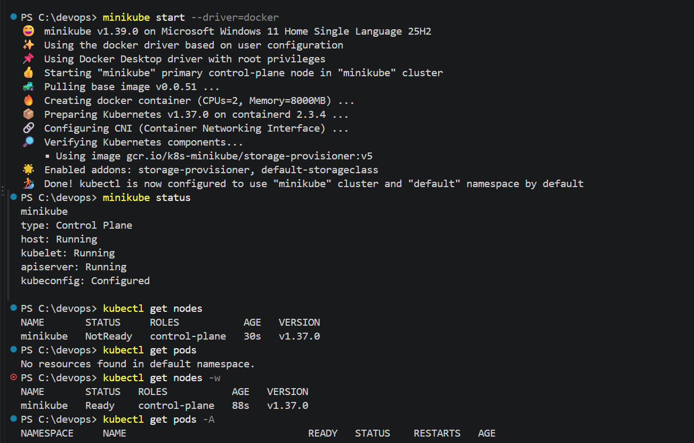
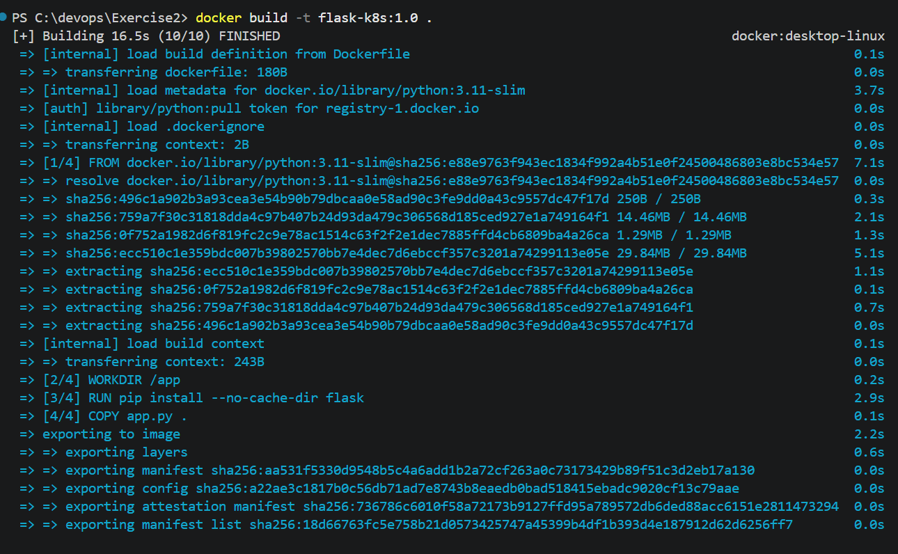
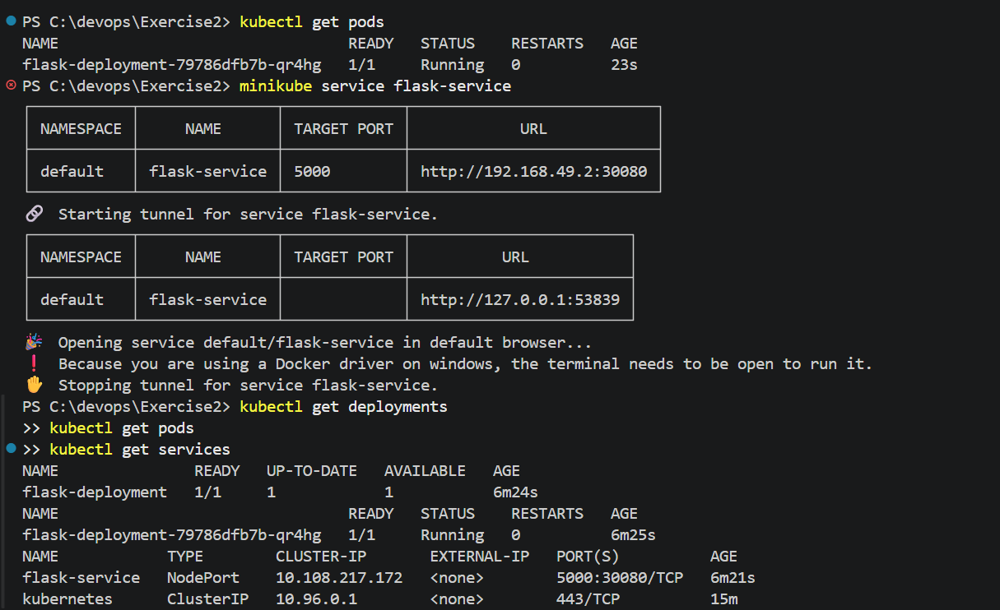
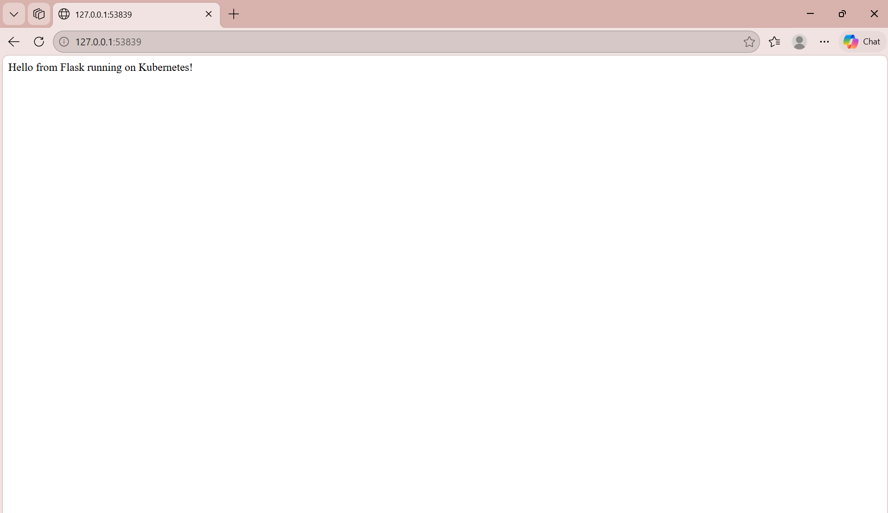

# Exercise 2

## Steps of Execution

### Run the following commands:

#### 1. Check Minikube Status

Verify that Minikube is running:

```powershell
minikube status
```



#### 2. Build the Docker Image

Navigate to the Exercise 2 directory:

```powershell
cd C:\devops\Exercise2
```

Build the Docker image:

```powershell
docker build -t flask-k8s:1.0 .
```

Verify that the image was created:

```powershell
docker images flask-k8s
```



#### 3. Load the Docker Image into Minikube

Load the locally built image into Minikube:

```powershell
minikube image load flask-k8s:1.0
```

#### 4. Deploy the Flask Application

Apply the Kubernetes Deployment configuration:

```powershell
kubectl apply -f deployment.yaml
```

#### 5. Create the Kubernetes Service

Apply the Service configuration:

```powershell
kubectl apply -f service.yaml
```

#### 6. Check Deployment Status

Run:

```powershell
kubectl get deployments
```

The `flask-deployment` Deployment should show one desired replica and one available replica.

#### 7. Verify the Running Pod

Run:

```powershell
kubectl get pods
```

The Flask Pod should show `1/1` under READY and `Running` under STATUS.

#### 8. Describe the Deployment

Inspect the Deployment configuration, replica status, container image, and events:

```powershell
kubectl describe deployment flask-deployment
```

#### 9. View Application Logs

Run:

```powershell
kubectl logs deployment/flask-deployment
```

These logs help verify that the Flask application has started successfully.

#### 10. Verify the Kubernetes Service

Run:

```powershell
kubectl get services
```

The `flask-service` Service should show type `NodePort` and port mapping `5000:30080/TCP`.



#### 11. Access the Flask Application

Run:

```powershell
minikube service flask-service
```

Keep the terminal open while the service tunnel is running.

The browser should display:

`Hello from Flask running on Kubernetes!`

### Output Screenshot



### Result

Successfully built a Docker image for a Python Flask application and deployed it on a local Kubernetes cluster using Minikube. The Kubernetes Deployment created a running Pod, and the NodePort Service exposed the application for access through a web browser.cd C:\devops