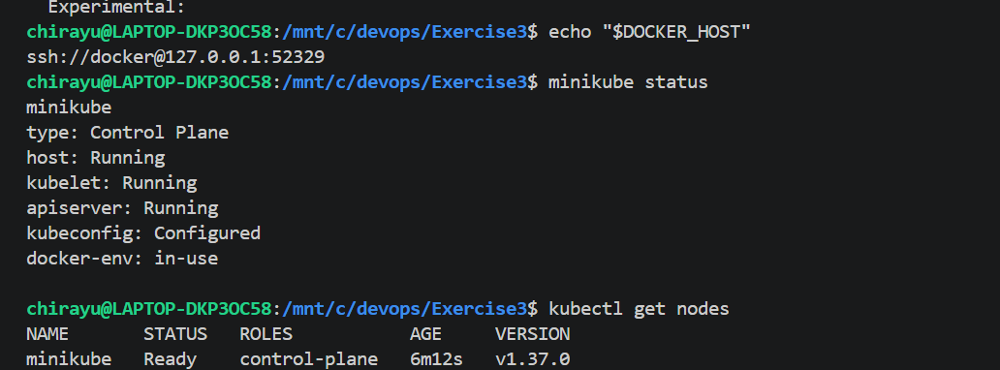
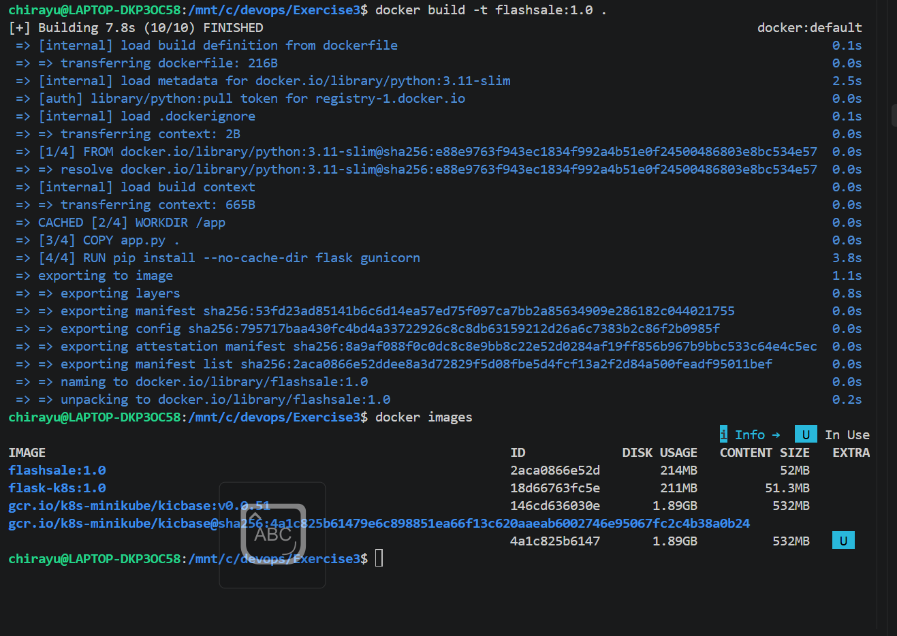
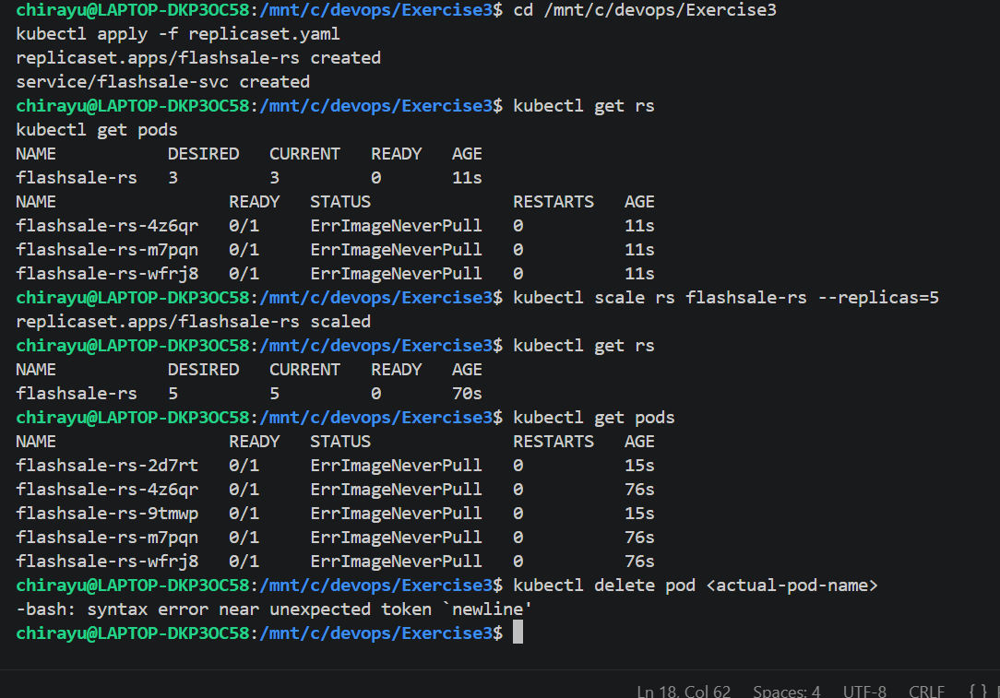
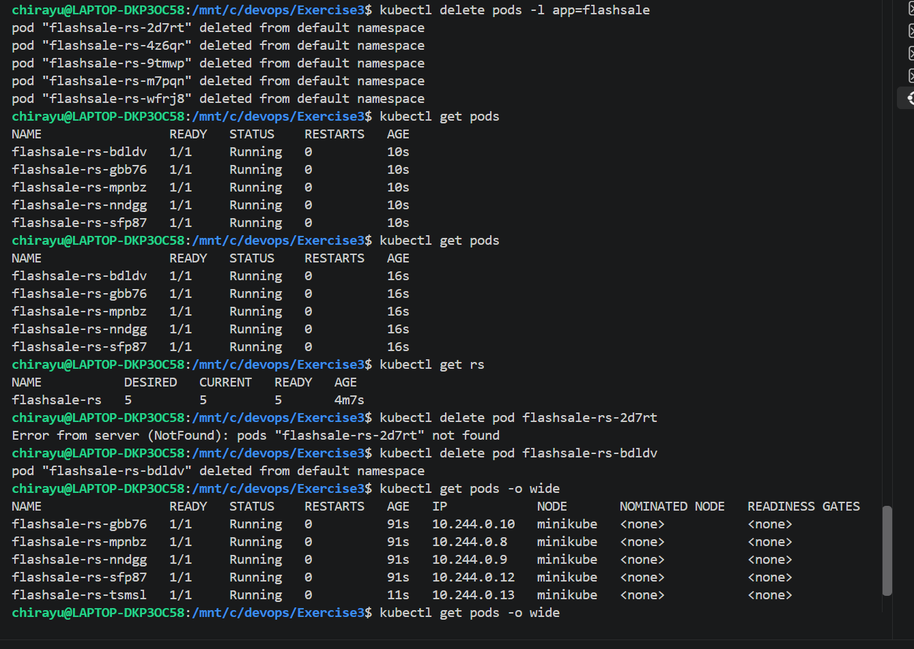

# Exercise 3: Scaling a Flask App Using ReplicaSets

## Real-Life Use Case: E-commerce Flash Sale

During an e-commerce flash sale, such as Big Billion Days or Prime Day, the number of incoming requests can increase significantly. A single application Pod may struggle to handle the increased workload. Kubernetes ReplicaSets help maintain multiple identical Pods, allowing the application to handle more requests and recover automatically when a Pod fails or is deleted.

## Objective

- Understand ReplicaSets and Pods.
- Build and deploy a Flask application using Docker and Kubernetes.
- Scale the application from 3 to 5 replicas.
- Observe Pod status and distribution.
- Demonstrate Kubernetes self-healing through automatic Pod replacement.

## App: Flash Sale Checkout Service

The Flask application simulates a simple flash sale checkout service.

It provides the following endpoints:

- `/` – Displays a welcome message, the serving Pod's hostname, and the timestamp.
- `/buy` – Simulates a purchase by selecting an item such as a smartphone, shoes, headphones, or laptop.
- `/health` – Returns the application's health status and the serving Pod's hostname.

The application uses Flask to handle HTTP requests and Python libraries to generate timestamps, identify the serving Pod, and simulate purchases.

## Dockerfile

The Dockerfile packages the Flask application and its dependencies into a container image using Python 3.11 and Gunicorn.

```dockerfile
FROM python:3.11-slim

WORKDIR /app

COPY app.py .

RUN pip install --no-cache-dir flask gunicorn

EXPOSE 5000

CMD ["gunicorn", "-b", "0.0.0.0:5000", "app:app", "--workers", "1", "--threads", "2"]
```

## Step 1: Confirm Minikube is Running

Verify that Minikube and its Kubernetes components are running:

```bash
minikube status
kubectl get nodes
```

The Minikube components should be running, and the Kubernetes node should show a `Ready` status.



## Step 2: Build the Docker Image

Navigate to the Exercise 3 directory:

```bash
cd /mnt/c/devops/Exercise3
```

Build the Docker image:

```bash
docker build -t flashsale:1.0 .
```

Load the image into Minikube:

```bash
minikube image load flashsale:1.0
```

Verify that the image is available:

```bash
minikube image ls | grep flashsale
```



## Step 3: ReplicaSet and Service YAML

The `replicaset.yaml` file defines the ReplicaSet and the Service.

The ReplicaSet is named `flashsale-rs` and initially maintains three Pods. Each Pod runs the `flashsale:1.0` image on container port 5000.

The configuration includes readiness and liveness probes that use the `/health` endpoint, along with CPU and memory requests and limits.

The `flashsale-svc` Service uses the `ClusterIP` type, exposing port 80 and forwarding requests to port 5000 on the application Pods.

## Step 4: Apply the ReplicaSet

Apply the Kubernetes configuration:

```bash
kubectl apply -f replicaset.yaml
```

Verify that the ReplicaSet and Service have been created:

```bash
kubectl get rs
kubectl get svc
```

## Step 5: Verify Initial Pods and ReplicaSet

Run the following commands:

```bash
kubectl get pods
kubectl get rs
```

Initially, three Pods should be created by the ReplicaSet. Wait until all three Pods show `Running` and `1/1` under READY.



## Step 6: Scale Up to 5 Replicas

Increase the number of replicas from three to five to simulate increased demand during a flash sale:

```bash
kubectl scale rs flashsale-rs --replicas=5
```

Verify the updated replica count:

```bash
kubectl get rs
kubectl get pods
```

Kubernetes creates two additional Pods to reach the desired count of five. Wait until all five Pods are running and ready.

## Step 7: Delete a Pod and Observe Self-Healing

Delete one of the currently running Pods:

```bash
kubectl get pods
kubectl delete pod POD_NAME
```

Replace `POD_NAME` with an actual Pod name displayed by `kubectl get pods`.

Verify the replacement:

```bash
kubectl get pods -o wide
kubectl get rs
```

Kubernetes automatically creates a replacement Pod to maintain the desired replica count. The new Pod generally has a different name from the deleted Pod.



## Key Observations

- **Pod Distribution** — Each Pod runs an instance of the same application, and scaling creates additional instances.
- **Resiliency** — When a Pod is deleted, the ReplicaSet creates a replacement to maintain the desired replica count.
- **Scalability** — The application can scale from three to five replicas using a single command.
- **Health Monitoring** — Readiness and liveness probes check the health of the application through the `/health` endpoint.
- **Service Discovery** — The Kubernetes Service provides a stable endpoint for accessing the application Pods.
- **Resource Management** — CPU and memory requests and limits help define the resources allocated to the application containers.

## Q&A

**Q1: What is the initial number of replicas?**

A: The ReplicaSet initially maintains 3 replicas.

**Q2: What happens when scaling to 5 replicas?**

A: Kubernetes creates 2 additional Pods to reach the desired count of 5.

**Q3: What happens when a Pod is deleted?**

A: The ReplicaSet automatically creates a replacement Pod to maintain the desired replica count.

**Q4: How does Kubernetes maintain the desired replica count?**

A: It continuously compares the actual number of Pods with the desired count and creates replacement Pods when necessary.

**Q5: What is the purpose of the Kubernetes Service?**

A: The Service provides a stable endpoint for accessing the application Pods.

**Q6: What is the purpose of the health probes?**

A: Readiness probes determine whether a Pod is ready to receive traffic, while liveness probes check whether the container is healthy.

**Q7: How many Kubernetes nodes are used in this exercise?**

A: One node is used in the local Minikube cluster. Multiple Pods can run on the same node.

## Result

Successfully built and deployed a Flask application using Docker and Kubernetes ReplicaSets. The application was initially deployed with three replicas and scaled to five replicas to demonstrate horizontal scaling. Deleting a running Pod demonstrated Kubernetes' self-healing capability by automatically creating a replacement. The exercise provided practical experience with Docker image management, ReplicaSets, Kubernetes Services, health probes, scaling, and Pod recovery.