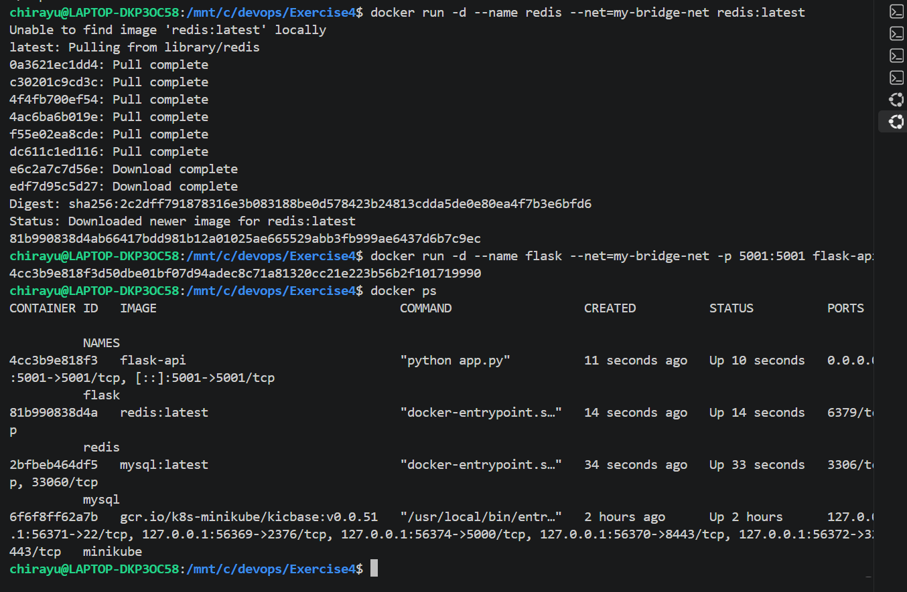
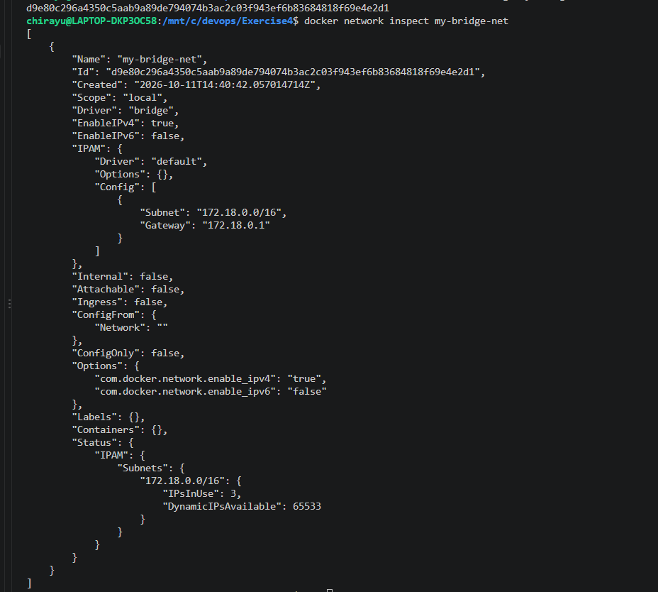
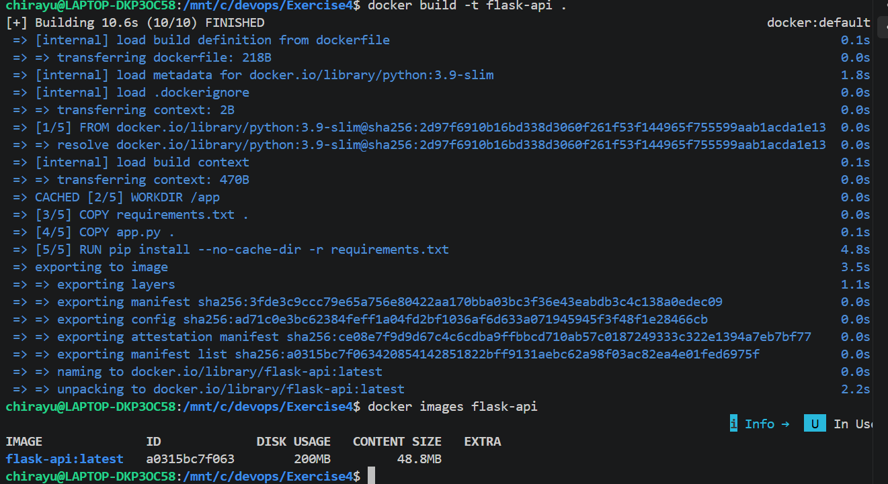
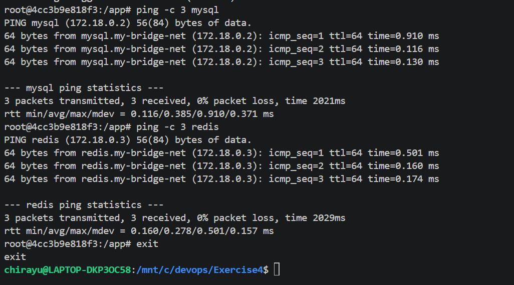
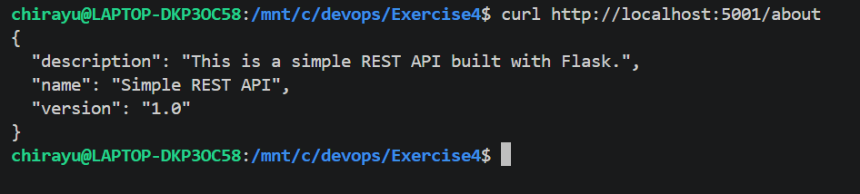

# Exercise 4: Docker Networking with Multiple Containers

## Objective

Understand Docker networking concepts and configure a multi-container application where services communicate over a custom bridge network.

## Scenario

A web application composed of three containers:

- A Python Flask web server
- A MySQL database
- A Redis cache

## Steps of Execution

### Step 1: Create a Bridge Network

Create a custom bridge network named `my-bridge-net`:

```bash
docker network create --driver bridge my-bridge-net
```

This network allows containers to communicate with each other.

### Step 2: Verify the Network

List the available Docker networks:

```bash
docker network ls
```

The `my-bridge-net` network should appear in the list with the `bridge` driver.



### Step 3: Inspect the Network

Inspect the configuration of the custom bridge network:

```bash
docker network inspect my-bridge-net
```

The output displays the network ID, driver, subnet, gateway, and connected containers.



### Step 4: Create the Flask Application

Create `app.py` with the following code:

```python
from flask import Flask, jsonify

app = Flask(__name__)

@app.route('/about', methods=['GET'])
def about():
    return jsonify({
        "name": "Simple REST API",
        "version": "1.0",
        "description": "This is a simple REST API built with Flask."
    })

if __name__ == '__main__':
    app.run(debug=True, host='0.0.0.0', port=5001)
```

Create `requirements.txt`:

```text
Flask==2.0.1
Werkzeug==2.0.3
```

**Note:** Werkzeug is pinned to version 2.0.3 to maintain compatibility with Flask 2.0.1 and avoid the `url_quote` import error caused by newer Werkzeug versions.

Create a `Dockerfile`:

```dockerfile
FROM python:3.9-slim

WORKDIR /app

COPY requirements.txt .
COPY app.py .

RUN pip install --no-cache-dir -r requirements.txt

EXPOSE 5001

CMD ["python", "app.py"]
```

### Step 5: Build the Flask Image

Build the Docker image:

```bash
docker build -t flask-api .
```

Verify that the image was created:

```bash
docker images flask-api
```



### Step 6: Launch All Three Containers on the Bridge Network

Start the MySQL database container:

```bash
docker run -d --name mysql --net=my-bridge-net -e MYSQL_ROOT_PASSWORD=rootpass mysql:latest
```

Start the Redis cache container:

```bash
docker run -d --name redis --net=my-bridge-net redis:latest
```

Start the Flask application container:

```bash
docker run -d --name flask --net=my-bridge-net -p 5001:5001 flask-api
```

Verify that the containers are running:

```bash
docker ps
```

The output should show the `mysql`, `redis`, and `flask` containers running.

### Step 7: Test Connectivity Between Containers

Enter the Flask container:

```bash
docker exec -it flask bash
```

Install the ping utility:

```bash
apt-get update && apt-get install -y iputils-ping
```

Test connectivity to MySQL:

```bash
ping -c 3 mysql
```

Test connectivity to Redis:

```bash
ping -c 3 redis
```

Both containers responded successfully, confirming that the Flask container can resolve their names and communicate over the custom bridge network.

Exit the container:

```bash
exit
```



### Step 8: Test the Flask API from the Host Machine

Run the following command from the Ubuntu WSL terminal:

```bash
curl http://localhost:5001/about
```

The API returns a JSON response similar to:

```json
{
  "description": "This is a simple REST API built with Flask.",
  "name": "Simple REST API",
  "version": "1.0"
}
```

This confirms that the Flask API is accessible from the host machine through port 5001.



### Step 9: Clean Up

After taking all screenshots and completing the tests, stop the containers:

```bash
docker stop mysql redis flask
```

Remove the containers:

```bash
docker rm mysql redis flask
```

Remove the custom bridge network:

```bash
docker network rm my-bridge-net
```

## Key Observations

- **Custom Networking** — A user-defined bridge network allows containers to communicate over an isolated virtual network.
- **Container Name Resolution** — Containers on the same user-defined bridge network can communicate using their container names.
- **Multi-Container Setup** — Flask, MySQL, and Redis run as separate containers on the same network.
- **Port Mapping** — The `-p 5001:5001` option exposes the Flask API to the host machine.
- **Connectivity Testing** — Successful ping responses demonstrate connectivity between the Flask container and the MySQL and Redis containers.
- **API Verification** — The Flask API returns the expected JSON response when accessed through `localhost:5001/about`.

## Q&A

**Q1: What is the purpose of the `--net` flag in `docker run`?**

A: It specifies which Docker network the container should connect to.

**Q2: How do containers communicate with each other on the same network?**

A: Containers on the same user-defined bridge network can resolve each other by container name using Docker's built-in DNS and communicate over their internal IP addresses.

**Q3: What is the difference between a bridge network and a host network?**

A: A bridge network connects containers through an isolated virtual network and typically requires port mapping for host access. A host network shares the host's network stack directly, providing less network isolation.

**Q4: How can you expose a container's port to the host machine?**

A: Use the `-p` flag. For example, `-p 5001:5001` maps host port 5001 to container port 5001.

## Result

Successfully created a custom Docker bridge network and deployed a multi-container application consisting of a Flask API, MySQL database, and Redis cache. Verified the network configuration, tested communication between containers using their names, and accessed the Flask API from the host machine through port mapping. The exercise demonstrated practical Docker networking, container communication, port mapping, and multi-container application management.