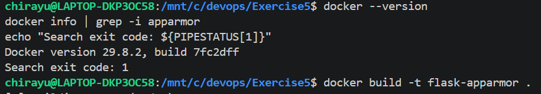
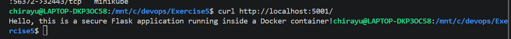

# Exercise 5: Docker Security with AppArmor and Python

## Objective

Understand Docker container security using AppArmor, learn how security profiles can restrict container access, and test a containerized Flask application.

## Scenario

A Python Flask application is packaged into a Docker image and run inside a container. The objective is to apply an AppArmor security profile to restrict access to sensitive files, directories, and system operations, and verify that the application continues to work.

## Platform Finding: AppArmor Is Not Available in This Setup

Before applying an AppArmor profile, the Docker environment was checked for AppArmor support using:

```bash
docker info | grep -i apparmor
echo "Search exit code: ${PIPESTATUS[1]}"
```



**Result:** The search returned exit code `1`, indicating that no matching AppArmor entry was found in the Docker information output.

This indicates that AppArmor support was not reported by the current Docker environment. AppArmor is a Linux kernel security module, and its availability depends on the host kernel and Docker configuration. Therefore, the absence of an AppArmor entry should be treated as an environment limitation that requires further verification, rather than proof that every security profile is silently ignored.

## Step 1: Create the Flask Application

Create a file named `app.py` with the following code:

```python
from flask import Flask

app = Flask(__name__)

@app.route('/')
def home():
    return "Hello, this is a secure Flask application running inside a Docker container!"

if __name__ == '__main__':
    app.run(host='0.0.0.0', port=5000)
```

The Flask application exposes a root endpoint (`/`) that returns a message when accessed through a browser or an HTTP client.

## Step 2: Create the Dockerfile

Create a file named `Dockerfile`:

```dockerfile
FROM python:3.8-slim

WORKDIR /app

COPY . /app

RUN pip install --no-cache-dir flask

EXPOSE 5000

CMD ["python", "app.py"]
```

The Dockerfile uses Python 3.8 slim as the base image, installs Flask, copies the application into the container, and exposes port `5000`.

## Step 3: Build the Docker Image

Build the image using:

```bash
docker build -t flask-apparmor .
```

Verify that the image was created:

```bash
docker images flask-apparmor
```


**Result:** The `flask-apparmor:latest` image was built successfully and is available locally.

## Step 4: Attempt to Run the Container with an AppArmor Profile

Run the following command to request the use of an AppArmor profile:

```bash
docker run --security-opt="apparmor=my-apparmor-profile" \
  -p 5001:5000 \
  -d \
  --name flask-apparmor-test \
  flask-apparmor
```


The container started successfully and was listed as running. The host port `5001` was mapped to container port `5000`, allowing the application to be accessed through `http://localhost:5001/`.

**Security observation:** Successful container startup does not establish that the requested AppArmor profile was loaded or enforced. The actual security behavior depends on the Docker engine and host kernel support.

## Step 5: Confirm That the Flask Application Works

Test the application using:

```bash
curl http://localhost:5001/
```



**Response:**

```text
Hello, this is a secure Flask application running inside a Docker container!
```

This confirms that the Flask application is responding successfully through the published port.

## Step 6: Inspect the Container Security Configuration

Inspect the security options configured for the container:

```bash
docker inspect flask-apparmor-test \
  --format '{{json .HostConfig.SecurityOpt}}'
```

The output can show the security options supplied when the container was created. However, the presence of an option in the container configuration does not independently prove that the corresponding security profile is being enforced.

To check the container status, run:

```bash
docker ps -a
```

## What a Working AppArmor Profile Would Do

On a Linux host that supports AppArmor, a properly designed and loaded profile can restrict a container's access to selected files, directories, executables, capabilities, and other system resources.

For example, a profile can be designed to:

- Restrict access to sensitive system configuration files.
- Limit write access to selected directories.
- Restrict execution of unnecessary binaries.
- Deny dangerous Linux capabilities.
- Reduce the potential impact of a compromised application.

A profile must be written for the application, validated, loaded into the host's AppArmor system, and applied to the container. Its enforcement should then be verified with appropriate tests on a supported Linux environment.

## Conclusion

This exercise demonstrated how to build a Docker image for a Flask application, start a container with a requested AppArmor security option, inspect the container configuration, and test the application's HTTP response.

The Docker image was built successfully, the container started, and the Flask endpoint returned the expected response. However, the Docker information search did not report AppArmor support. Consequently, successful application execution and container startup should not be interpreted as proof of AppArmor enforcement. A Linux environment with verified AppArmor support is required to fully demonstrate and test profile-based restrictions.

## Q&A

**Q1. What is the purpose of AppArmor in Docker?**

AppArmor provides mandatory access control on supported Linux systems. It can restrict what a containerized application is permitted to access or execute.

**Q2. How does an AppArmor profile help secure a container?**

A profile defines security rules that allow or deny selected operations. When properly enforced, these rules can reduce the potential impact of an application compromise.

**Q3. Why should access to sensitive directories be restricted?**

Directories containing system configuration and application secrets may expose sensitive information or permit unwanted changes if access is not appropriately controlled.

**Q4. Does successful container startup prove that AppArmor is working?**

No. The container can start and the application can respond even when AppArmor enforcement has not been established. Host support and profile enforcement must be verified separately.

**Q5. How can the container's security options be inspected?**

The `docker inspect` command can display the configured security options through the `HostConfig.SecurityOpt` field. This shows configuration, not conclusive proof of enforcement.