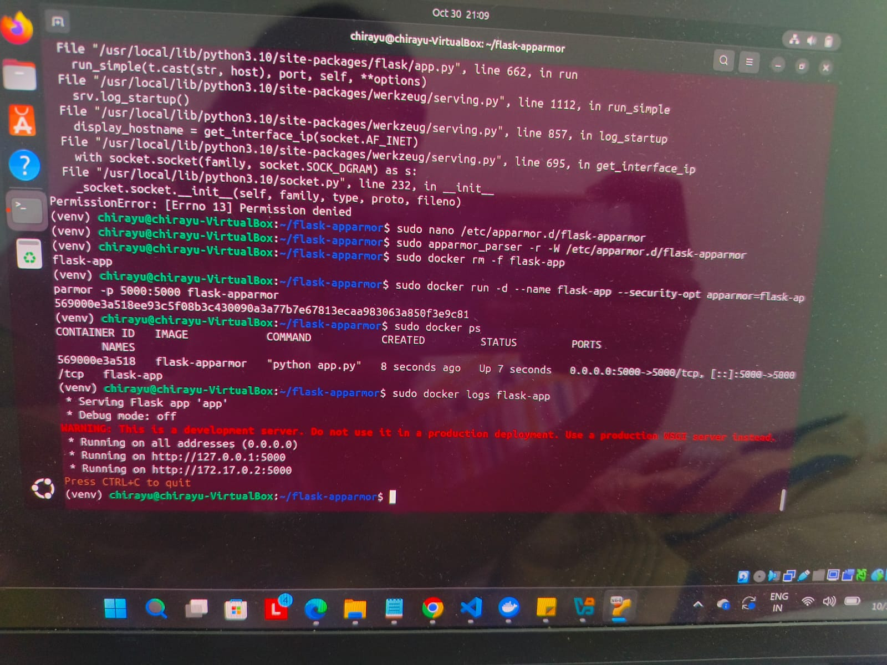
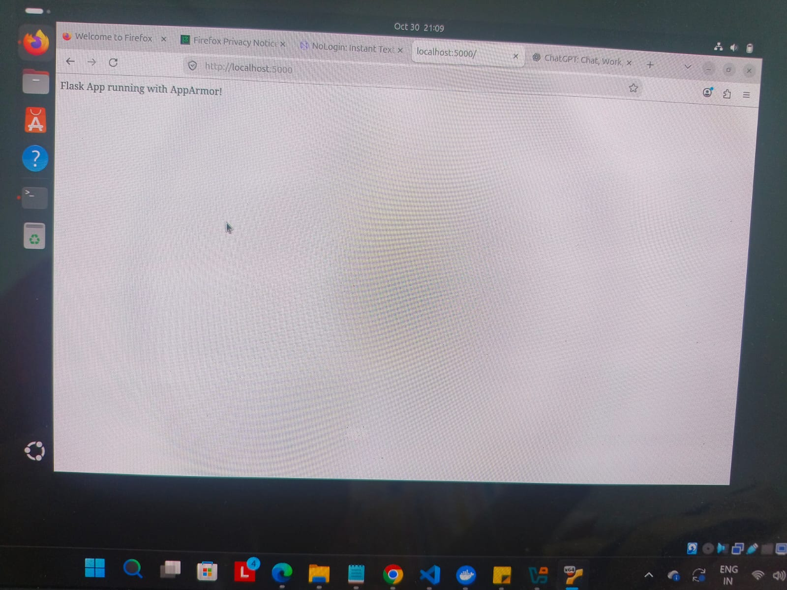
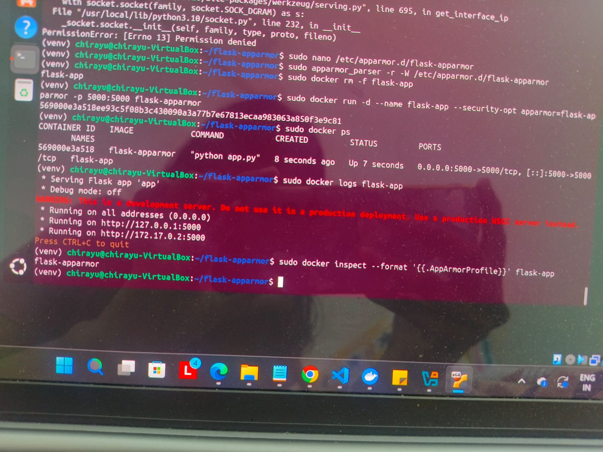
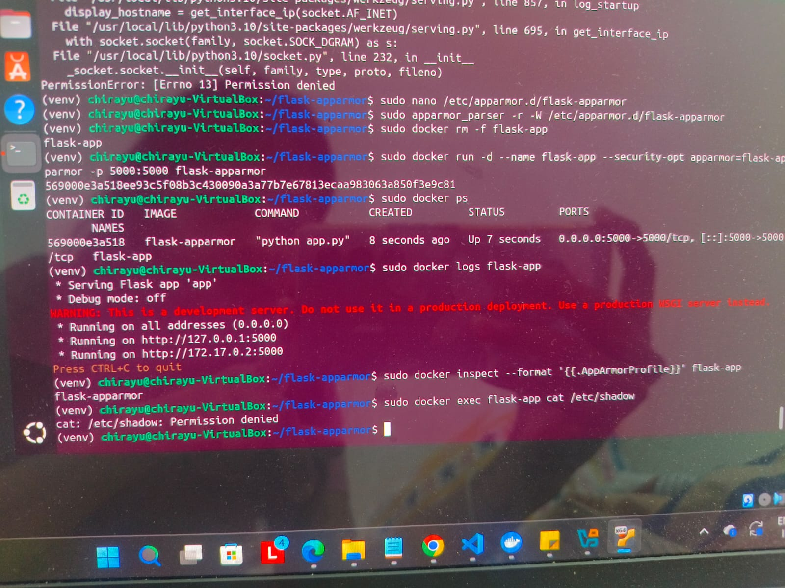
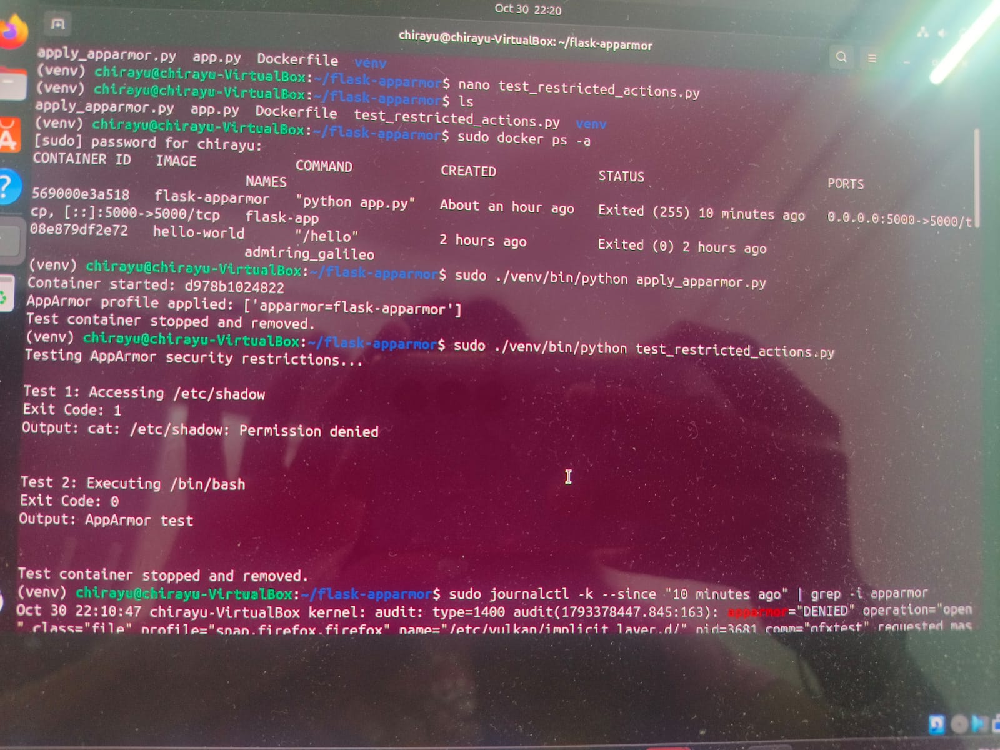

# Exercise 5: Docker Security with AppArmor

## Objective

To secure a Flask application running inside a Docker container using AppArmor. A custom AppArmor security profile is created and attached to the Docker container to restrict access to sensitive system files and prevent unauthorized operations. Python Docker SDK scripts are also used to automate container configuration and test security restrictions.

## Tools and Technologies

- Ubuntu 24.04 LTS
- Docker
- AppArmor
- Python 3.10
- Flask
- Docker SDK for Python
- VirtualBox

## Steps of Execution

### Step 1: Set Up Ubuntu VM and Verify AppArmor

Ubuntu 24.04.5 LTS was installed and configured inside VirtualBox.

Check whether AppArmor is enabled:

```bash
cat /sys/module/apparmor/parameters/enabled
```

Check whether the AppArmor filesystem is mounted:

```bash
mount | grep apparmor
```

Install AppArmor utilities:

```bash
sudo apt update
sudo apt install -y apparmor-utils
```

### Step 2: Create the Flask Application

Create a project directory:

```bash
mkdir flask-apparmor
cd flask-apparmor
```

Create the Flask application:

```bash
nano app.py
```

Add the following code:

```python
from flask import Flask

app = Flask(__name__)

@app.route('/')
def home():
    return "Flask App running with AppArmor!"

if __name__ == '__main__':
    app.run(host='0.0.0.0', port=5000)
```

### Step 3: Create the Dockerfile and Build the Image

Create a Dockerfile:

```bash
nano Dockerfile
```

Add the following configuration:

```dockerfile
FROM python:3.10-slim

WORKDIR /app

COPY app.py .

RUN pip install flask

EXPOSE 5000

CMD ["python", "app.py"]
```

Build the Docker image:

```bash
sudo docker build -t flask-apparmor .
```

Verify the image:

```bash
sudo docker images
```

### Step 4: Create a Custom AppArmor Profile

Create a custom profile:

```bash
sudo nano /etc/apparmor.d/flask-apparmor
```

Add the following configuration:

```text
#include <tunables/global>

profile flask-apparmor flags=(attach_disconnected,mediate_deleted) {
    #include <abstractions/base>

    # Allow network communication
    network inet stream,
    network inet6 stream,

    # Allow Python libraries
    /usr/local/bin/python r,
    /usr/local/lib/python3.10/** mr,

    # Allow Flask application access
    /app/** r,

    # Allow temporary file access
    /tmp/** rw,

    # Deny access to sensitive files
    deny /etc/shadow r,
    deny /etc/gshadow r,

    # Restrict root directory access
    deny /root/** rwklx,

    # Restrict system administration capability
    deny capability sys_admin,
}
```

Parse and load the profile:

```bash
sudo apparmor_parser -r -W /etc/apparmor.d/flask-apparmor
```

Verify that the profile is loaded:

```bash
sudo aa-status | grep flask-apparmor
```

### Step 5: Run the Docker Container with AppArmor Security

Remove any previously created container with the same name:

```bash
sudo docker rm -f flask-app
```

Run the container with the custom AppArmor profile:

```bash
sudo docker run -d \
--name flask-app \
--security-opt apparmor=flask-apparmor \
-p 5000:5000 \
flask-apparmor
```

Check whether the container is running:

```bash
sudo docker ps
```

Check the application logs:

```bash
sudo docker logs flask-app
```

The Flask application starts and listens on port 5000.



### Step 6: Access the Flask Application

Open Firefox inside the Ubuntu VM and visit:

```text
http://localhost:5000
```

The browser displays:

**Flask App running with AppArmor!**



### Step 7: Verify AppArmor Security Restrictions

Check which AppArmor profile is attached to the Docker container:

```bash
sudo docker inspect --format '{{.AppArmorProfile}}' flask-app
```

Expected output:

```text
flask-apparmor
```

Attempt to access the protected shadow file from inside the container:

```bash
sudo docker exec flask-app cat /etc/shadow
```

The command returns `Permission denied` because the custom AppArmor profile restricts access to this sensitive file.





### Step 8: Install the Python Docker SDK

Create and activate a Python virtual environment:

```bash
python3 -m venv venv
source venv/bin/activate
```

Install the Docker SDK:

```bash
pip install docker
```

The Docker SDK allows Python scripts to communicate with the Docker Engine and manage containers programmatically.

### Step 9: Automate AppArmor Configuration Using Python SDK

Create the Python script:

```bash
nano apply_apparmor.py
```

The script uses the Docker SDK to:

1. Connect to the Docker Engine.
2. Build the Flask Docker image.
3. Start a container with the custom AppArmor profile.
4. Inspect the container security configuration.
5. Stop and remove the test container.

Execute the script:

```bash
sudo ./venv/bin/python apply_apparmor.py
```

The output confirms that the container was started and the `flask-apparmor` security profile was attached successfully.

### Step 10: Test Restricted Actions Using Python SDK

Create the testing script:

```bash
nano test_restricted_actions.py
```

The script performs two security tests:

**Test 1: Restricted file access**

Attempts to read `/etc/shadow` from inside the container.

**Test 2: System binary execution**

Attempts to execute `/bin/bash` inside the container.

Execute the script:

```bash
sudo ./venv/bin/python test_restricted_actions.py
```

Observed results:

- Access to `/etc/shadow` was denied with a permission error.
- Execution of `/bin/bash` was successful in this test.

The test container is stopped and removed after execution.



### Step 11: Verify AppArmor Denial Logs

Check the Ubuntu kernel logs for AppArmor security events:

```bash
sudo journalctl -k --since "10 minutes ago" | grep -i apparmor
```

The logs contain AppArmor denial entries associated with the custom profile, demonstrating that restricted operations are being recorded by the Linux kernel.

## Result

Successfully deployed a Flask application inside a Docker container with a custom AppArmor security profile. The Flask application was accessible through the browser, while access to the protected `/etc/shadow` file was denied. Python Docker SDK scripts were also executed to automate container configuration and test security restrictions. The kernel logs provided additional evidence of AppArmor enforcement.