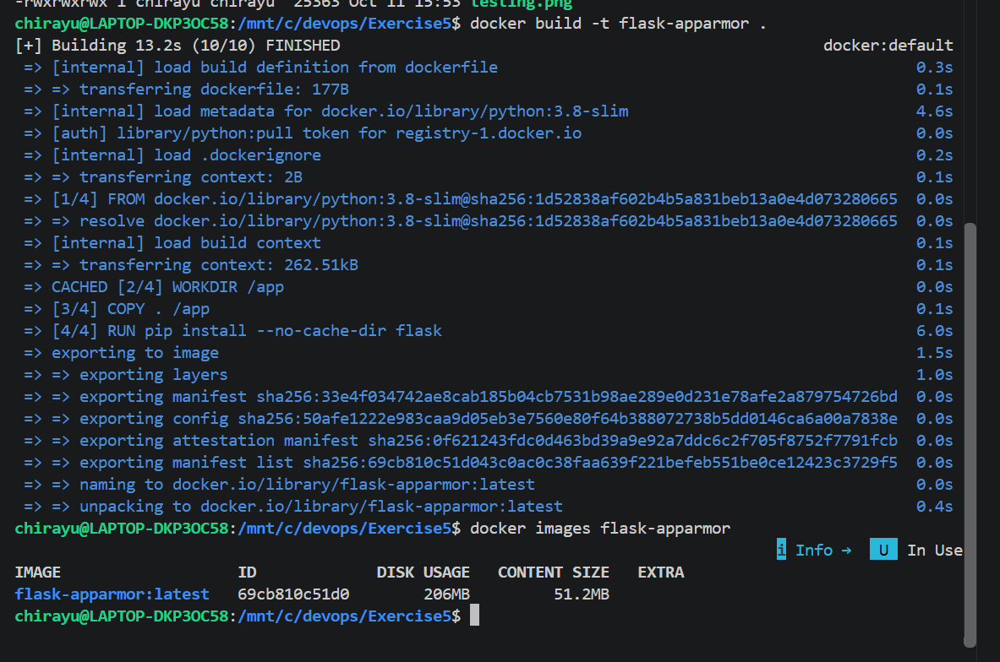
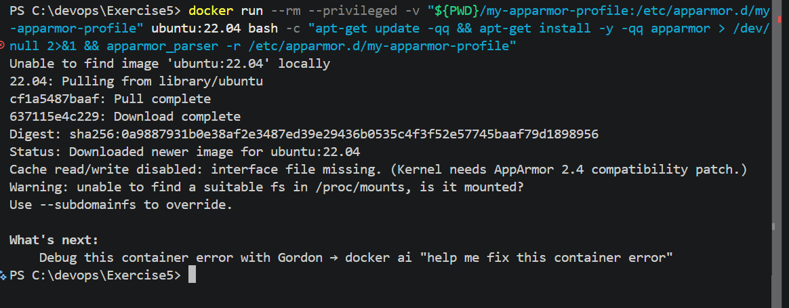
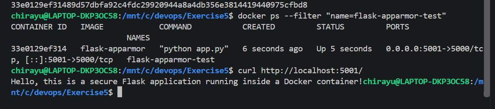
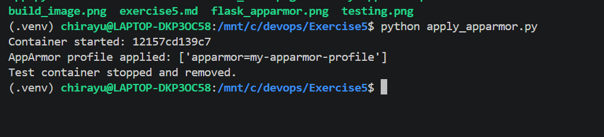
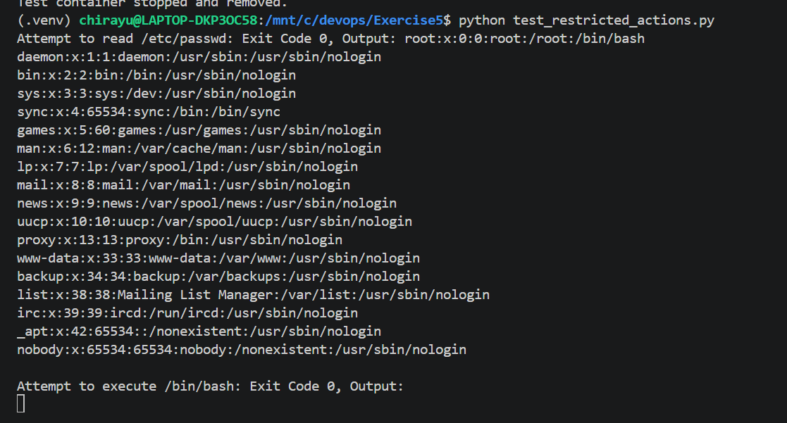

# Exercise 5: Docker Security with AppArmor

## Objective

To explore Docker container security using AppArmor profiles, apply a security profile to a Docker container, and test whether restricted actions are blocked.

## Scenario

A Flask application is packaged inside a Docker container. An AppArmor profile is defined to restrict access to sensitive files, limit execution of certain binaries, and control capabilities. The profile is then passed to Docker, and restricted actions are tested to evaluate whether the security restrictions are enforced.

**Environment:** Windows 11, Docker Desktop, Ubuntu on WSL, Python, and the Docker Python SDK.

## Prerequisites

- Docker Desktop installed and running.
- Ubuntu WSL integrated with Docker Desktop.
- Python 3 installed in WSL.
- VS Code.
- A Flask application and Docker image.

## Files Used

| File | Description |
|---|---|
| `app.py` | Flask application |
| `dockerfile` | Instructions to build the Docker image |
| `my-apparmor-profile` | AppArmor profile definition |
| `apply_apparmor.py` | Applies the requested profile using the Docker SDK |
| `test_restricted_actions.py` | Tests access to sensitive files and binary execution |
| `build_image.png` | Docker image build screenshot |
| `flask_apparmor.png` | Flask application response screenshot |
| `apparmor_load.png` | AppArmor profile-loading attempt |
| `apply_apparmor.png` | Python SDK test output |
| `test_restricted_actions.png` | Restricted-action test output |

---

## Task 1: Create the Flask Application

The Flask application returns a message when accessed through its root endpoint.

The application is saved in `app.py`.

```python
from flask import Flask

app = Flask(__name__)

@app.route('/')
def home():
    return "Hello, this is a secure Flask application running inside a Docker container!"

if __name__ == '__main__':
    app.run(host='0.0.0.0', port=5000)
```

## Task 2: Build the Docker Image

The Dockerfile defines the Python environment, copies the application into the container, installs Flask, exposes port 5000, and starts the application.

The file in the project folder is named `dockerfile`.

Build the image from the `Exercise5` directory:

```bash
docker build -f dockerfile -t flask-apparmor .
```

The image was built successfully and was available for creating containers.

### Screenshot: Docker Image Build



## Task 3: Define and Attempt to Load the AppArmor Profile

The profile is saved in `my-apparmor-profile`. It specifies restrictions for sensitive files, binary execution, network access, application-directory access, and capabilities.

The profile definition is:

```text
#include <tunables/global>

/usr/bin/python3 {
    # Deny access to sensitive system files
    deny /etc/** r,
    deny /var/** rw,

    # Allow Flask app to bind to port 5000
    network inet stream,

    # Permissions to the application directory
    /app/** rwk,

    # Deny execution of any binaries in /bin or /usr/bin
    deny /bin/** rmix,
    deny /usr/bin/** rmix,

    # Capability restrictions
    capability net_bind_service,
    deny capability sys_admin,
}
```

The profile-loading attempt was executed from Windows PowerShell in the `Exercise5` directory:

```powershell
docker run --rm --privileged -v "${PWD}/my-apparmor-profile:/etc/apparmor.d/my-apparmor-profile" ubuntu:22.04 bash -c "apt-get update -qq && apt-get install -y -qq apparmor > /dev/null 2>&1 && apparmor_parser -r /etc/apparmor.d/my-apparmor-profile"
```

The command downloaded the Ubuntu image and attempted to load the profile. However, it reported that the AppArmor interface file was missing and that a suitable filesystem could not be found in `/proc/mounts`.

These messages indicate that the required AppArmor support was unavailable in the current Docker Desktop/WSL kernel environment.

### Screenshot: AppArmor Profile-Loading Attempt



### Run the Flask Container

The Flask container was started with the requested AppArmor security option and host port 5001:

```bash
docker run --security-opt="apparmor=my-apparmor-profile" -p 5001:5000 -d --name flask-apparmor-test flask-apparmor
```

The container status was checked:

```bash
docker ps --filter "name=flask-apparmor-test"
```

The application was tested using:

```bash
curl http://localhost:5001/
```

The application returned:

```text
Hello, this is a secure Flask application running inside a Docker container!
```

This confirmed that the Flask application was accessible through the mapped host port. It did not confirm that AppArmor restrictions were enforced.

### Screenshot: Flask Application Response



## Task 4: Apply the Profile Using the Python Docker SDK

The Docker Python SDK was installed inside a Python virtual environment in WSL.

```bash
python3 -m venv .venv
source .venv/bin/activate
python -m pip install docker
```

Docker connectivity was verified using:

```bash
python -c "import docker; print(docker.from_env().version())"
```

The `apply_apparmor.py` script builds the image, starts a temporary container with the requested security option, inspects its Docker configuration, and removes the container.

```python
import docker

client = docker.from_env()

client.images.build(path=".", tag="flask-apparmor")

container = client.containers.run(
    "flask-apparmor",
    ports={"5000/tcp": 5002},
    security_opt=["apparmor=my-apparmor-profile"],
    detach=True
)

print(f"Container started: {container.short_id}")

container_info = client.api.inspect_container(container.id)
apparmor_profile = container_info["HostConfig"]["SecurityOpt"]

print(f"AppArmor profile applied: {apparmor_profile}")

container.stop()
container.remove()
print("Test container stopped and removed.")
```

The script was executed using:

```bash
python apply_apparmor.py
```

The output confirmed that the container started, Docker reported the requested security option, and the temporary container was stopped and removed.

The reported option confirms that the configuration was requested through Docker. It does not demonstrate that the kernel loaded or enforced the profile.

### Screenshot: Python SDK Test



## Task 5: Test Restricted Actions

The `test_restricted_actions.py` script tests whether the container can read `/etc/passwd` and execute `/bin/bash`.

```python
import docker

client = docker.from_env()

container = client.containers.run(
    "flask-apparmor",
    ports={"5000/tcp": 5002},
    security_opt=["apparmor=my-apparmor-profile"],
    detach=True
)

try:
    exit_code, output = container.exec_run("cat /etc/passwd")
    print(
        f"Attempt to read /etc/passwd: "
        f"Exit Code {exit_code}, Output: {output.decode()}"
    )

    exit_code, output = container.exec_run("/bin/bash")
    print(
        f"Attempt to execute /bin/bash: "
        f"Exit Code {exit_code}, Output: {output.decode()}"
    )
finally:
    container.stop()
    container.remove()
```

The script was executed using:

```bash
python test_restricted_actions.py
```

### Actual Results

| Test | Observed result | Interpretation |
|---|---|---|
| Read `/etc/passwd` | Exit code `0`; file contents were returned | The file read was not blocked. |
| Execute `/bin/bash` | Exit code `0` | The command was not denied; this result alone does not prove an interactive shell was opened. |

Both tests completed without an AppArmor denial. These results are consistent with the earlier profile-loading failure: AppArmor enforcement was not demonstrated in the current environment.

### Screenshot: Restricted-Action Test



## Results and Discussion

The Flask application was successfully containerized and accessed through the host port mapping. The AppArmor profile was defined and supplied to Docker as a security option. The Docker Python SDK was also used successfully to create and inspect a container.

However, the attempt to load the AppArmor profile failed because the required AppArmor filesystem and kernel support were unavailable in the current Docker Desktop/WSL environment. The restricted-action tests consequently returned exit code `0` rather than demonstrating that the requested restrictions were enforced.

The experiment therefore demonstrates the container setup, profile configuration attempt, SDK interaction, and security testing procedure, but **it does not demonstrate successful AppArmor enforcement**.

## Conclusion

This exercise explored Docker container security using an AppArmor profile. A Flask application was built into a Docker image, launched as a container, and tested through its HTTP endpoint. A profile was defined and passed to Docker using both command-line options and the Python Docker SDK.

The profile-loading attempt failed because the current environment did not provide the required AppArmor kernel support. Both restricted-action tests were therefore allowed to complete, and successful enforcement could not be verified. The results highlight the importance of checking host-kernel support before relying on a container security profile.
