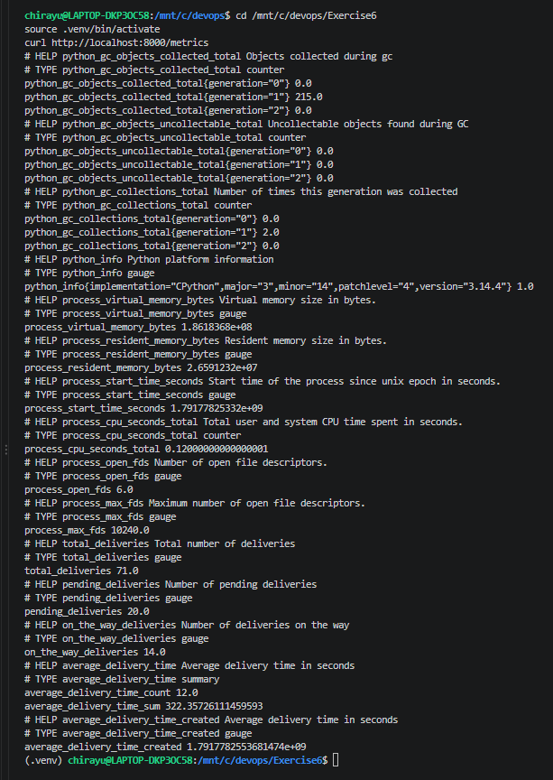
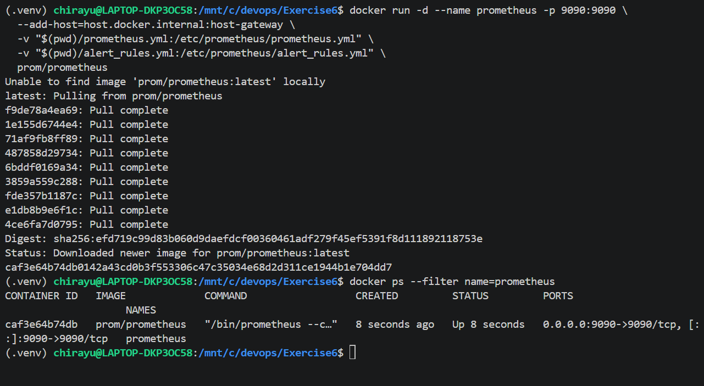
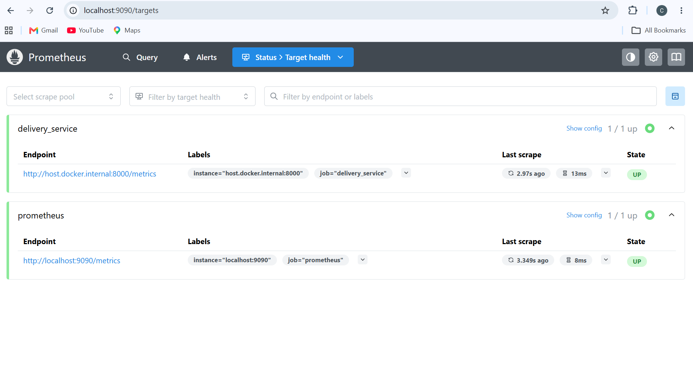
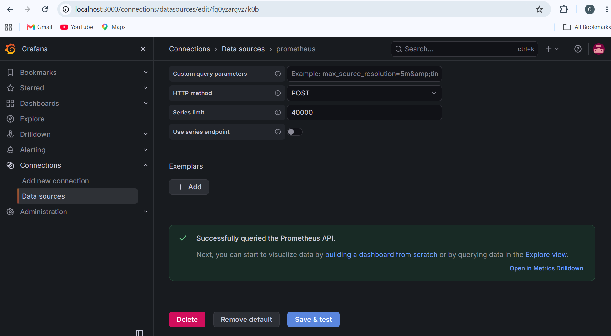
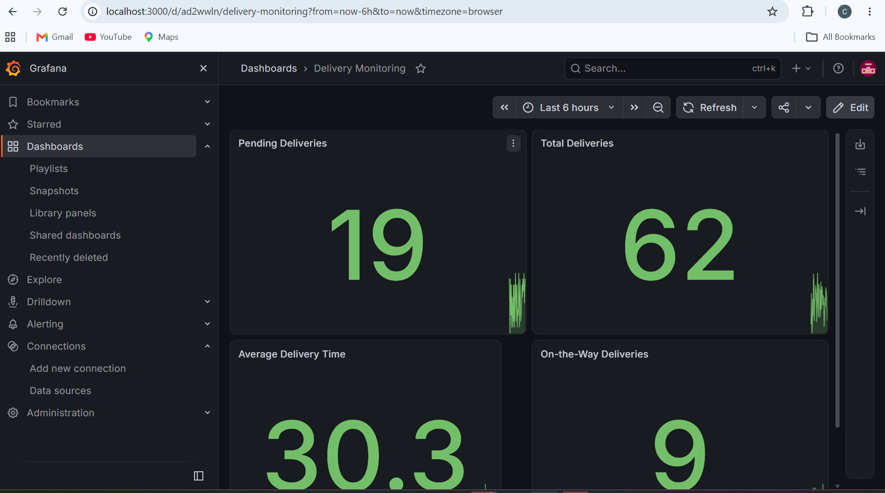
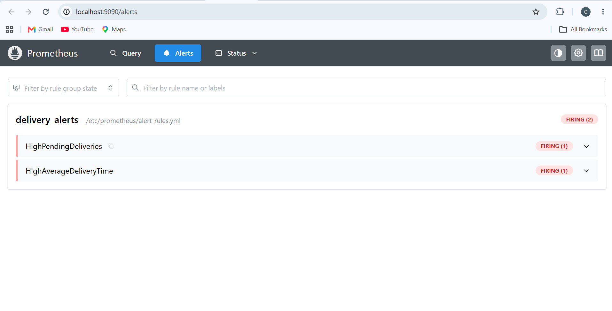

# Exercise 6: Real-Time Operations Monitoring and Alerting

## Objective

Build a monitoring pipeline for a simulated delivery service using Python, Prometheus, and Grafana to generate metrics, monitor operations, and visualize data in real time.

## Scenario

As a DevOps engineer at a delivery service, create a system that monitors delivery metrics and identifies operational issues using dashboards and automated alerts.

## Step 1: Install the Python Package

```bash
cd /mnt/c/devops/Exercise6
source .venv/bin/activate
python -m pip install prometheus-client
```

## Step 2: Create the Metrics Simulation Script

Create `delivery_metrics.py` to generate simulated delivery metrics, including total deliveries, pending deliveries, deliveries on the way, and average delivery time.

The script updates the metrics every second and exposes them on port `8000`.

Run the script and verify the metrics endpoint:

```bash
python delivery_metrics.py &
curl http://localhost:8000/metrics
```



## Step 3: Configure Prometheus

Create `prometheus.yml` with the following scrape configuration:

```yaml
scrape_configs:
  - job_name: "prometheus"
    static_configs:
      - targets: ["localhost:9090"]

  - job_name: "delivery_service"
    static_configs:
      - targets: ["host.docker.internal:8000"]

rule_files:
  - /etc/prometheus/alert_rules.yml
```

## Step 4: Configure Alert Rules

Create `alert_rules.yml` to define alerts for high pending deliveries and increased average delivery time.

```yaml
groups:
  - name: delivery_alerts
    rules:
      - alert: HighPendingDeliveries
        expr: pending_deliveries > 10
        for: 15s
        labels:
          severity: warning
        annotations:
          summary: "High pending deliveries"
          description: "Pending deliveries are above 10 for the last 15 seconds."

      - alert: HighAverageDeliveryTime
        expr: (average_delivery_time_sum / average_delivery_time_count) > 30
        labels:
          severity: critical
        annotations:
          summary: "High average delivery time"
          description: "Average delivery time is above 30 seconds."
```

## Step 5: Run Prometheus

Run Prometheus in Docker:

```bash
docker run -d --name prometheus -p 9090:9090 \
  --add-host=host.docker.internal:host-gateway \
  -v "$(pwd)/prometheus.yml:/etc/prometheus/prometheus.yml" \
  -v "$(pwd)/alert_rules.yml:/etc/prometheus/alert_rules.yml" \
  prom/prometheus
```

Access Prometheus at http://localhost:9090.



## Step 6: Verify Prometheus Targets

Open **Status → Targets** in Prometheus.

Both the `prometheus` and `delivery_service` targets should show **UP**, confirming that metrics are being collected successfully.



## Step 7: Run Grafana

Run Grafana in Docker:

```bash
docker run -d --name grafana -p 3000:3000 \
  --add-host=host.docker.internal:host-gateway \
  grafana/grafana
```

Open http://localhost:3000 and log in using `admin` as the username and `admin` as the initial password.


## Step 8: Configure the Grafana Data Source

Navigate to **Connections → Data sources → Add data source → Prometheus**.

Set the Prometheus server URL to:

```text
http://host.docker.internal:9090
```

Save and verify the connection.



## Step 9: Create the Grafana Dashboard

Create a dashboard named **Delivery Monitoring** with four panels using the following Prometheus queries.

| Panel | PromQL Query |
|---|---|
| Total Deliveries | `total_deliveries` |
| Pending Deliveries | `pending_deliveries` |
| On-the-Way Deliveries | `on_the_way_deliveries` |
| Average Delivery Time | `average_delivery_time_sum / average_delivery_time_count` |

The dashboard displays live delivery metrics generated by the Python script.



## Step 10: Verify Alerts

Open **Alerts** in Prometheus to check the configured alert rules.

- **HighPendingDeliveries:** Triggers when pending deliveries exceed 10 for 15 seconds.
- **HighAverageDeliveryTime:** Triggers when average delivery time exceeds 30 seconds.



## Expected Outputs

- **Metrics Endpoint:** Delivery metrics available at `http://localhost:8000/metrics`.
- **Prometheus:** Successfully scrapes the configured targets.
- **Grafana Dashboard:** Displays four delivery monitoring panels.
- **Alerting:** Detects high pending deliveries and increased average delivery time.