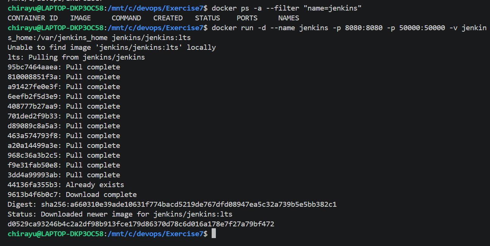
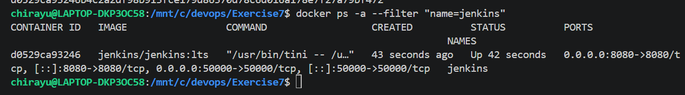
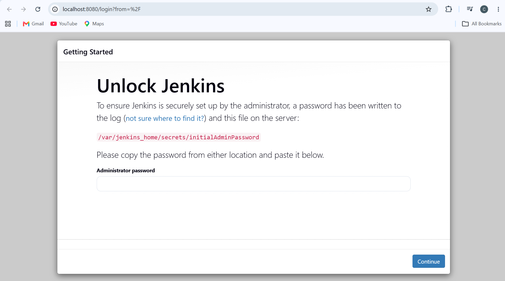
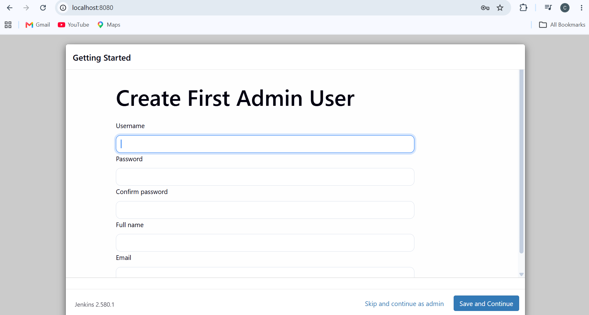
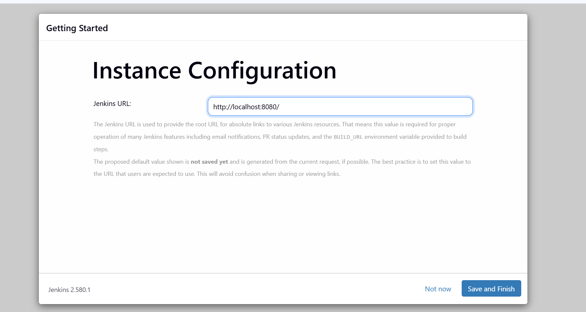
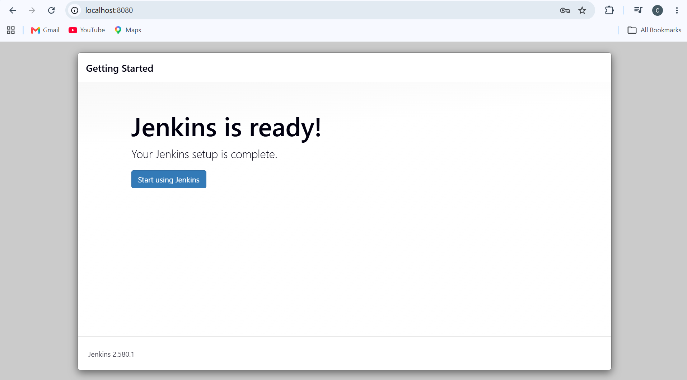

# Exercise 7: Introduction to Continuous Integration (CI) and Jenkins Installation

## What is Continuous Integration (CI)?

Continuous Integration is a software development practice in which developers frequently integrate code changes into a shared repository. Each integration can trigger automated builds and tests, helping identify errors early and maintain software quality.

## Key Features of CI

- **Frequent Code Integration** — Developers regularly commit and integrate changes into a shared repository.
- **Automated Builds** — Code is automatically built whenever configured changes are detected.
- **Automated Testing** — Tests run automatically to identify defects and regressions.
- **Immediate Feedback** — Developers receive build and test results quickly.

## Benefits of CI

- Early detection of bugs and integration issues.
- Improved collaboration among developers.
- Faster development cycles through automation.
- Better software quality through continuous testing.
- Reduced risk when integrating frequent code changes.

## How CI Works

1. A developer commits and pushes code to a version control repository.
2. A CI server detects the configured repository change.
3. The server retrieves the latest code and prepares the build environment.
4. Automated build and test steps execute.
5. The results are reported so developers can identify and fix failures.

## What is Jenkins?

Jenkins is an open-source automation server used to automate software building, testing, and deployment. It supports Continuous Integration and Continuous Delivery through configurable jobs, pipelines, and plugins.

## Key Jenkins Concepts

- **Job/Project** — A task or process configured to run in Jenkins.
- **Build** — An execution of a configured job or pipeline.
- **Pipeline** — A sequence of automated stages, such as building and testing an application.
- **Plugins** — Extensions that add integrations and capabilities to Jenkins.
- **Nodes** — Machines or environments where Jenkins jobs execute.

## Installing Jenkins via Docker

### Step 1: Run the Jenkins Container

Jenkins was installed using Docker in Ubuntu WSL. The container exposes port `8080` for the web interface and port `50000` for agent communication. A Docker volume is used to persist Jenkins configuration and data.

```bash
docker run -d --name jenkins -p 8080:8080 -p 50000:50000 -v jenkins_home:/var/jenkins_home jenkins/jenkins:lts
```



### Step 2: Verify the Container Is Running

The following command checks the Jenkins container status and port mappings.

```bash
docker ps -a --filter "name=jenkins"
```

The container was verified to be running, with port `8080` mapped to the host.



### Step 3: Retrieve the Initial Administrator Password

The initial administrator password was retrieved from the Jenkins container using:

```bash
docker exec jenkins cat /var/jenkins_home/secrets/initialAdminPassword
```

This password is required to unlock Jenkins during its first-time setup. The password is private and is not included in this documentation.

### Step 4: Access and Unlock Jenkins

Jenkins was accessed locally through the browser at [http://localhost:8080](http://localhost:8080). The initial administrator password was entered to unlock the installation.



### Step 5: Install Suggested Plugins

The **Install suggested plugins** option was selected to install commonly used Jenkins plugins. These plugins provide essential functionality for configuring jobs and automating development workflows.



### Step 6: Create the Administrator User

A first administrator account was configured to provide authenticated access to Jenkins. The account setup was completed without including login credentials in the project documentation.

### Step 7: Configure the Jenkins Instance URL

The default local Jenkins URL was retained for accessing the installation from the same machine.

```text
http://localhost:8080/
```



### Step 8: Complete the Jenkins Setup

After completing the initial configuration, Jenkins displayed the setup completion page. The **Start using Jenkins** option was available to proceed to the main interface.



### Step 9: Verify the Jenkins Installation

Jenkins was installed and configured successfully in a Docker container. The web interface was accessible locally, and the installation was ready for creating and running automation jobs.

## Conclusion

This exercise introduced the fundamentals of Continuous Integration and the role of Jenkins in automating software development workflows. Jenkins was installed through Docker in Ubuntu WSL, its container status and port mappings were verified, and the initial setup was completed through the web interface. The administrator account and local instance URL were configured successfully. This setup provides a foundation for future exercises involving Jenkins jobs, automated builds, testing, and CI/CD pipelines.

## Future Scope

- Create Jenkins jobs to automate application build and test operations.
- Integrate Jenkins with GitHub repositories to retrieve source code.
- Develop pipeline workflows using a `Jenkinsfile`.
- Add automated testing stages to detect defects early.
- Explore Docker-based application builds and deployment automation.