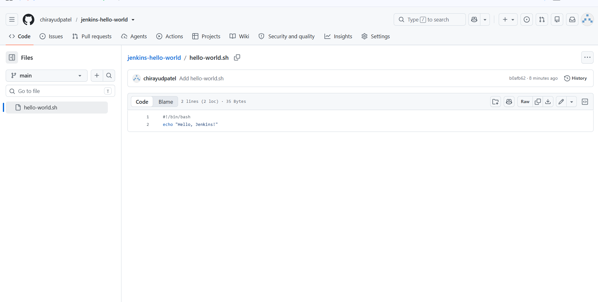
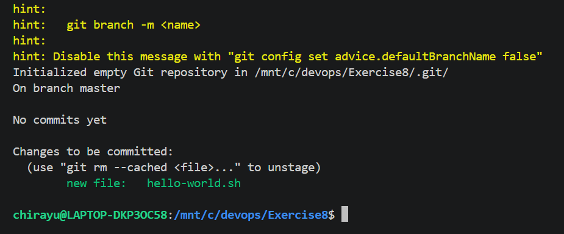
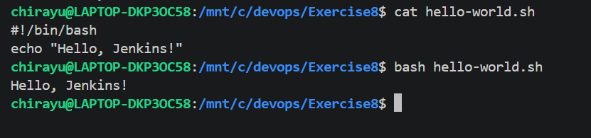
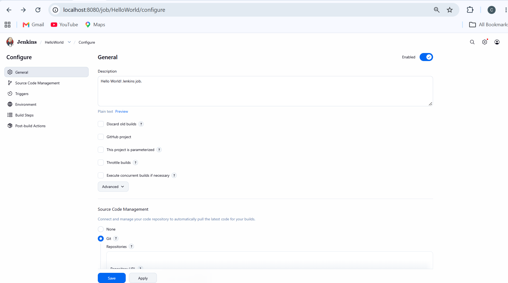
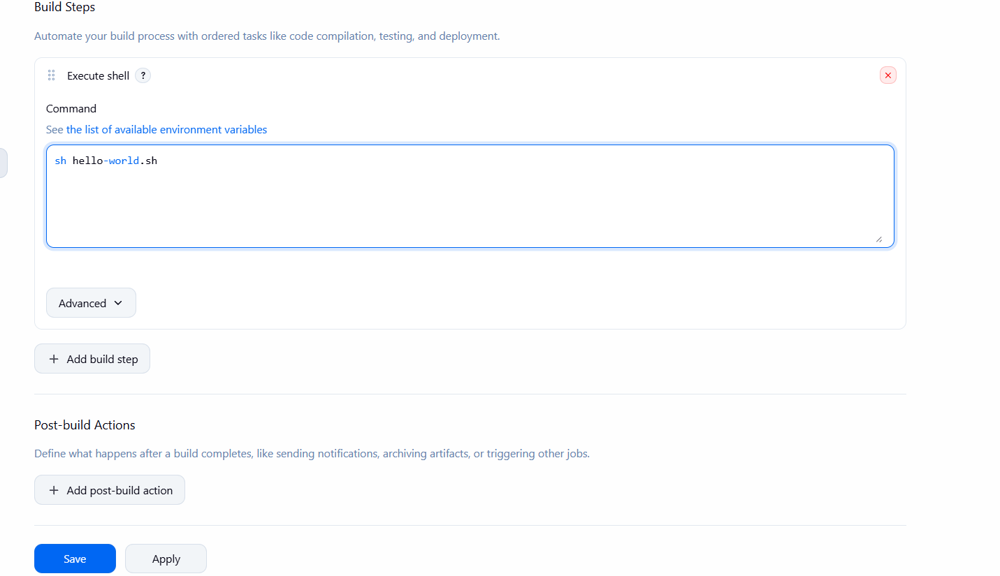
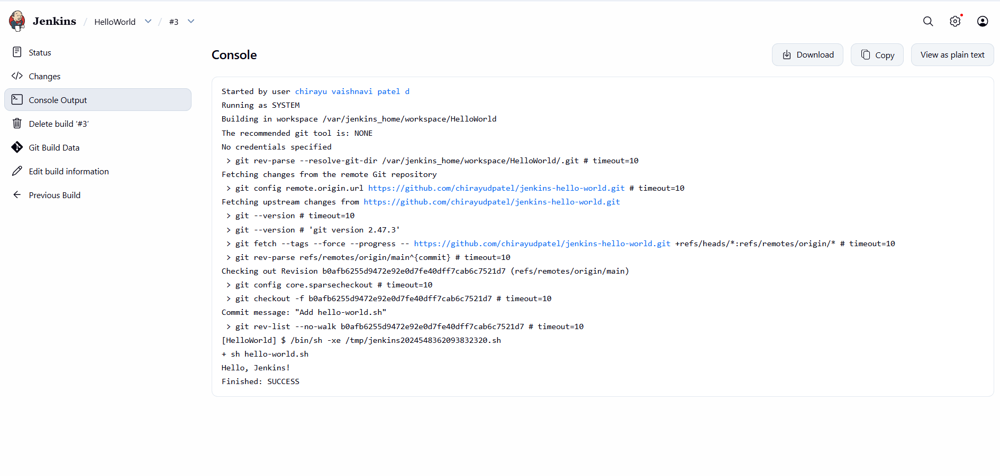

# Exercise 8: Creating a Hello World Jenkins Job

## Objective

Create a GitHub repository containing a simple shell script, then configure a Jenkins Freestyle job to retrieve the script from GitHub and execute it, demonstrating a basic Continuous Integration (CI) workflow.

## Step 1: Create the GitHub Repository

Created a public GitHub repository named `jenkins-hello-world` under the `chirayudpatel` account to store the shell script used by the Jenkins job.

Repository URL: https://github.com/chirayudpatel/jenkins-hello-world

## Step 2: Create the Hello World Script

Created a file named `hello-world.sh` containing a simple command to display a message.

```bash
#!/bin/bash
echo "Hello, Jenkins!"
```

The script was made executable and saved inside the `Exercise8` folder.



## Step 3: Initialize Git and Commit

Initialized a local Git repository, configured the Git branch as `main`, added the script, and committed the changes.

```bash
git init
git add hello-world.sh
git status
git commit -m "Add hello-world.sh"
git branch -M main
```

The Git status confirmed that `hello-world.sh` was staged for committing.



## Step 4: Push the Script to GitHub

Connected the local repository to GitHub and pushed the script to the `main` branch.

```bash
git remote add origin https://github.com/chirayudpatel/jenkins-hello-world.git
git push -u origin main
```

GitHub authentication was completed using a Personal Access Token instead of an account password. The script was successfully uploaded to the repository.

## Step 5: Verify the Script

Verified that `hello-world.sh` was available in the GitHub repository and that the script contained the expected command.



## Step 6: Create a Jenkins Freestyle Job

Opened Jenkins at http://localhost:8080 and created a new Freestyle project named `HelloWorld`.

Added the following description:

`Hello World! Jenkins job.`

### Source Code Management → Git

Selected **Git** and entered the repository URL:

`https://github.com/chirayudpatel/jenkins-hello-world.git`

Configured the branch specifier as:

`*/main`

This ensures Jenkins retrieves the script from the correct branch.



## Step 7: Configure the Build Step

Under **Build Steps**, selected **Execute shell** and entered:

```bash
sh hello-world.sh
```

This command executes the shell script retrieved from GitHub during the build.



## Step 8: Run the Jenkins Job

Saved the job configuration and selected **Build Now**. Jenkins retrieved the source code and executed the configured build step.

The build completed successfully, and the output displayed:

```text
Hello, Jenkins!
Finished: SUCCESS
```



## Key Takeaways

- Understood how Git and GitHub store and manage source code.
- Created and pushed a shell script to a GitHub repository.
- Configured Jenkins to retrieve source code from a Git repository.
- Learned how to create and configure a Jenkins Freestyle job.
- Executed a shell script through an automated build step.
- Verified build success using the Jenkins console output.

## Conclusion

This exercise demonstrated a basic Continuous Integration workflow using GitHub and Jenkins. The shell script was stored in a GitHub repository, retrieved by Jenkins, and executed through a Freestyle job. The successful build confirmed that source code management and automated command execution were working correctly.