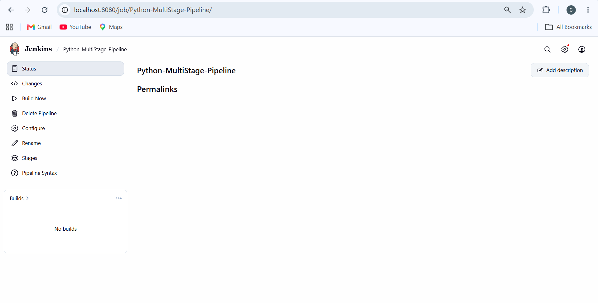

# Exercise 9: Jenkins Multi-Stage Pipeline — Deploying a Python Application

## Objective

Build a Jenkins Pipeline job that performs multiple stages — Build, Test, Deploy, Run Application, and Test Application — for a sample Flask application, demonstrating a realistic multi-stage CI/CD workflow.

## Scenario

Automate the CI/CD pipeline for a Python Flask application through five stages:

- **Build:** Prepare the application environment.
- **Test:** Run unit tests.
- **Deploy:** Copy the application to a mock deployment directory.
- **Run Application:** Start the deployed application in the background.
- **Test Application:** Verify the deployed application using unit tests.

## Step 1: Flask Application

Created the following files inside the `Exercise9` folder.

**app.py**

```python
from flask import Flask

app = Flask(__name__)

@app.route("/")
def home():
    return "Hello, Jenkins Multi-Stage Pipeline!"

if __name__ == "__main__":
    app.run(debug=True)
```

**requirements.txt**

```text
flask==2.1.2
```

**test_app.py**

```python
import unittest
from app import app

class TestApp(unittest.TestCase):
    def test_home(self):
        tester = app.test_client()
        response = tester.get("/")
        print(response.data.decode("utf-8"))
        self.assertEqual(response.status_code, 200)
        self.assertEqual(
            response.data.decode("utf-8"),
            "Hello, Jenkins Multi-Stage Pipeline!"
        )

if __name__ == "__main__":
    unittest.main()
```

## Step 2: Jenkinsfile

Created a `Jenkinsfile` containing a declarative pipeline with five stages: Build, Test, Deploy, Run Application, and Test Application.

The pipeline executes unit tests, copies `app.py` into a deployment directory, starts the deployed application in the background, and runs the test again. The `post` section displays a success or failure message based on the pipeline result.

## Step 3: Push to the Existing Repository

Added the Exercise 9 files to the existing GitHub repository:

Repository: `https://github.com/chirayudpatel/devops`

The files are stored inside the `Exercise9` directory and were committed and pushed to the `main` branch.

```bash
git add Exercise9/app.py Exercise9/requirements.txt Exercise9/test_app.py Exercise9/Jenkinsfile
git commit -m "Add Exercise 9 Jenkins multi-stage pipeline"
git push origin main
```


## Step 4: Create the Jenkins Pipeline Job

In Jenkins, selected **New Item**, entered `Python-MultiStage-Pipeline` as the job name, selected **Pipeline**, and clicked **OK**.

## Step 5: Configure Pipeline from SCM

Configured the pipeline to retrieve the `Jenkinsfile` from the existing GitHub repository.

- **Definition:** Pipeline script from SCM
- **SCM:** Git
- **Repository URL:** `https://github.com/chirayudpatel/devops.git`
- **Branch Specifier:** `*/main`
- **Script Path:** `Exercise9/Jenkinsfile`

Saved the configuration and triggered the first build.

## Step 6: First Run — Python Missing in the Container

The initial pipeline execution failed because `python3` was not available inside the Jenkins container. The Test stage could not execute the unit tests, so the remaining stages were skipped.

The Jenkins container needed Python and Flask installed before the pipeline could run successfully.

## Step 7: Install Python and Flask Inside the Jenkins Container

Opened the running Jenkins container as the root user:

```bash
docker exec -it -u root jenkins bash
```

Installed the required packages:

```bash
apt-get update
apt install -y python3
apt install -y python3-pip
apt install -y python3-flask
```

Verified the installation:

```bash
python3 --version
python3 -c "import flask; print(flask.__version__)"
```

Exited the container:

```bash
exit
```


**Note:** Installing packages directly inside the running container changes its writable layer. If the container is removed and recreated, the installation may need to be repeated.

## Step 8: Re-run the Pipeline — Full Success

After installing Python and Flask, triggered another build using **Build Now**.

The pipeline executed the following stages:

1. **Build:** Prepared the application environment.
2. **Test:** Executed the Flask unit test.
3. **Deploy:** Copied `app.py` into the deployment directory.
4. **Run Application:** Started the deployed application in the background.
5. **Test Application:** Executed the test again.




The console output showed the test results, the expected application response, the post-build success message, and the final status `Finished: SUCCESS`.

## Key Takeaways

- Jenkins Pipeline jobs define the CI/CD workflow as code using a `Jenkinsfile`.
- The Jenkins environment must contain the required runtime and application dependencies.
- Unit tests verify application behavior before and after the deployment step.
- A multi-stage pipeline demonstrates the build, test, deploy, run, and post-deployment testing workflow.

## Additional Enhancements (Not Implemented)

- Add a code-quality stage using `flake8` or `pylint`.
- Deploy the application into a separate Docker container instead of a local directory.
- Configure build notifications through email or Slack.