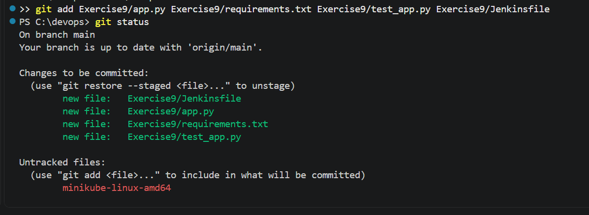
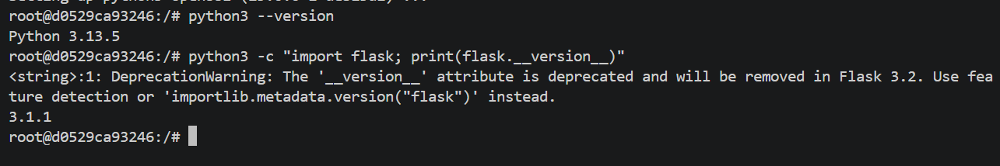
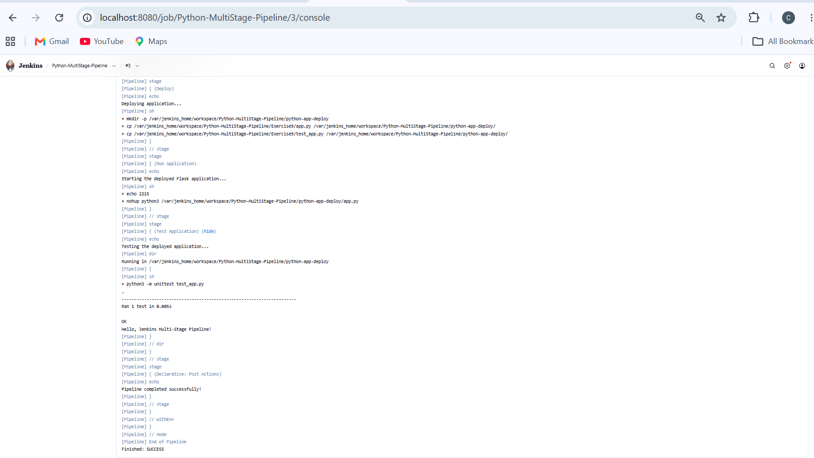

# Exercise 9: Jenkins Multi-Stage Pipeline — Deploying a Python Application

## Objective

Build a Jenkins Pipeline job that performs multiple stages — Build, Test, Deploy, Run Application, and Test Application — for a sample Flask application, demonstrating a multi-stage CI/CD workflow.

## Scenario

Automate the CI/CD pipeline for a Python Flask application through five stages:

- **Build:** Prepare the application environment and dependencies.
- **Test:** Run unit tests.
- **Deploy:** Copy the application to a mock deployment directory.
- **Run Application:** Start the deployed application in the background.
- **Test Application:** Verify the application after deployment.

## Step 1: Create the Flask Application

The Flask application returns a simple greeting when the home route (`/`) is accessed.

**app.py**

```python
from flask import Flask

app = Flask(__name__)

@app.route("/")
def home():
    return "Hello, Jenkins Multi-Stage Pipeline!"

if __name__ == "__main__":
    app.run(debug=True)
```

**requirements.txt**

```text
flask==2.1.2
```

**test_app.py**

```python
import unittest
from app import app

class TestApp(unittest.TestCase):
    def test_home(self):
        tester = app.test_client()
        response = tester.get("/")
        print(response.data.decode("utf-8"))
        self.assertEqual(response.status_code, 200)
        self.assertEqual(
            response.data.decode("utf-8"),
            "Hello, Jenkins Multi-Stage Pipeline!"
        )

if __name__ == "__main__":
    unittest.main()
```

## Step 2: Create the Jenkinsfile

The `Jenkinsfile` defines the pipeline and its five stages. It includes unit testing, deployment to a local directory, application execution, post-deployment testing, and success or failure messages.

```groovy
pipeline {
    agent any

    stages {
        stage('Build') {
            steps {
                echo 'Creating virtual environment and installing dependencies...'
            }
        }

        stage('Test') {
            steps {
                echo 'Running tests...'
                sh 'python3 -m unittest discover -s .'
            }
        }

        stage('Deploy') {
            steps {
                echo 'Deploying application...'
                sh '''
                mkdir -p ${WORKSPACE}/python-app-deploy
                cp ${WORKSPACE}/app.py ${WORKSPACE}/python-app-deploy/
                '''
            }
        }

        stage('Run Application') {
            steps {
                echo 'Running application...'
                sh '''
                nohup python3 ${WORKSPACE}/python-app-deploy/app.py > ${WORKSPACE}/python-app-deploy/app.log 2>&1 &
                echo $! > ${WORKSPACE}/python-app-deploy/app.pid
                '''
            }
        }

        stage('Test Application') {
            steps {
                echo 'Testing application...'
                sh '''
                python3 ${WORKSPACE}/test_app.py
                '''
            }
        }
    }

    post {
        success {
            echo 'Pipeline completed successfully!'
        }

        failure {
            echo 'Pipeline failed. Check the console output.'
        }
    }
}
```

## Step 3: Push the Pipeline Files to GitHub

The application files and `Jenkinsfile` were added to the existing GitHub repository used for the previous exercise.

```bash
git add Exercise9/app.py Exercise9/requirements.txt Exercise9/test_app.py Exercise9/Jenkinsfile
git commit -m "Add Flask app, tests, and Jenkinsfile for multi-stage pipeline"
git push origin main
```

The Exercise 9 files were added to the existing repository.



## Step 4: Create the Jenkins Pipeline Job

In Jenkins, select **New Item**, enter `Python-MultiStage-Pipeline` as the item name, choose **Pipeline**, and click **OK**.

## Step 5: Configure Pipeline from SCM

Configure the pipeline to retrieve the `Jenkinsfile` from the GitHub repository.

- **Definition:** Pipeline script from SCM
- **SCM:** Git
- **Repository URL:** `https://github.com/chirayudpatel/devops.git`
- **Branch Specifier:** `*/main`

Save the configuration and run the pipeline.

## Step 6: Resolve the Missing Python Runtime

The initial pipeline execution failed because the Jenkins container did not have Python installed. The Test stage reported that `python3` could not be found, and the subsequent stages were skipped.

The Jenkins container therefore needed Python and Flask installed before the pipeline could execute the application and its tests.

## Step 7: Install Python and Flask in the Jenkins Container

Open a terminal and access the running Jenkins container as the root user:

```bash
docker exec -it -u root jenkins bash
```

Install the required packages inside the container:

```bash
apt-get update
apt install -y python3
apt install -y python3-pip
apt install -y python3-flask
```

Verify the installation:

```bash
python3 --version
python3 -c "import flask; print(flask.__version__)"
```

The installation was verified successfully, with Python and Flask available inside the Jenkins container.



Exit the container:

```bash
exit
```

**Note:** Installing packages inside a running container changes its writable layer. If the container is removed and recreated, these packages may need to be installed again. A custom Jenkins image containing the required dependencies is a more persistent approach.

## Step 8: Re-run the Pipeline

After installing Python and Flask, run the pipeline again using **Build Now**.

The pipeline executes the following stages:

1. **Build:** Prepare the application environment.
2. **Test:** Execute the unit test and verify the expected HTTP response.
3. **Deploy:** Copy `app.py` into the `python-app-deploy` directory.
4. **Run Application:** Start the deployed application in the background.
5. **Test Application:** Run the test again to verify the application after deployment.

The unit test passes, and the application returns the expected response:

```text
Hello, Jenkins Multi-Stage Pipeline!
```

The post-build action displays the success message, and the final build status is `SUCCESS`.



The successful execution demonstrates the complete multi-stage workflow, from testing the application to deploying it and performing a second test.

## Key Takeaways

- Jenkins Pipeline jobs define the CI/CD workflow as code using a `Jenkinsfile`.
- The Jenkins environment must contain the required runtime and application dependencies.
- Unit tests verify application behavior before and after the deployment step.
- A multi-stage pipeline demonstrates the build, test, deploy, run, and post-deployment testing workflow.
- Installing dependencies directly into a running container is convenient for experimentation, while a custom image provides a more reproducible environment.

## Additional Enhancements (Not Implemented)

- Add a code-quality stage using tools such as `flake8` or `pylint`.
- Deploy the application into a Docker container instead of a local directory.
- Add email or Slack notifications for pipeline success and failure.git add Exercise9/exercise9.md
