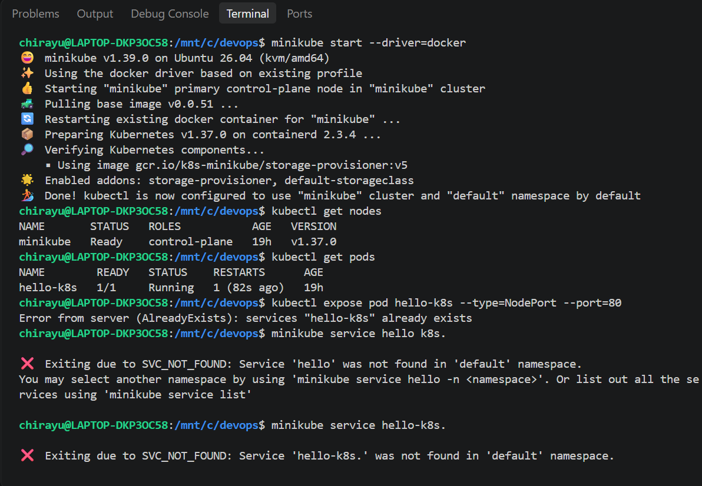
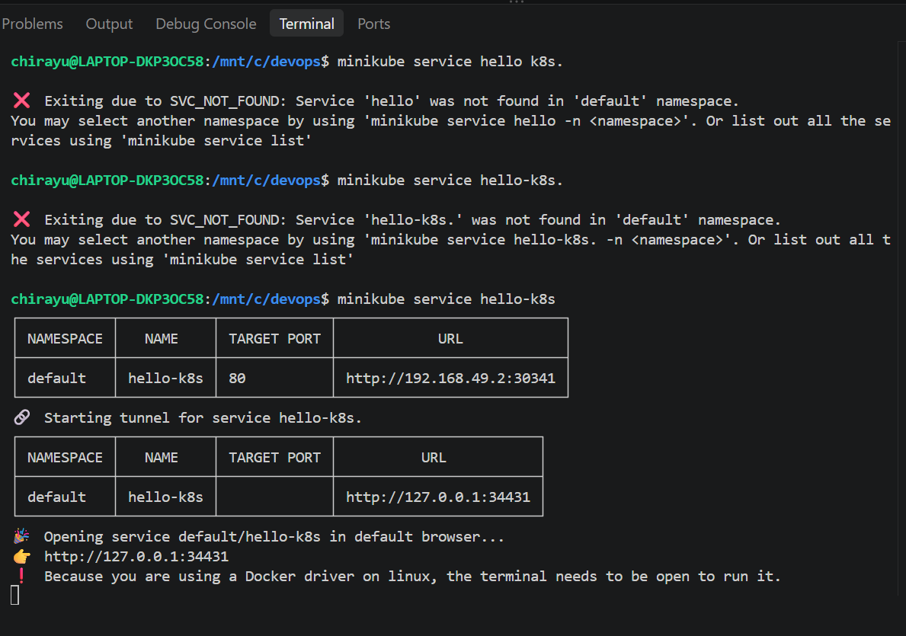
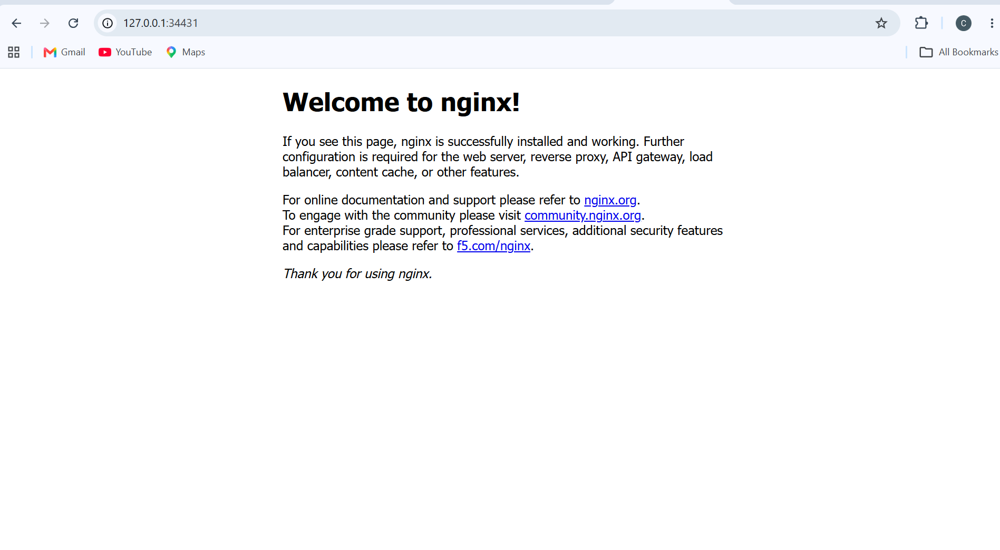

# Exercise 1: Getting Started with Kubernetes

## Objective
To set up a local Kubernetes environment using Minikube, deploy an Nginx container, and access the application through a Kubernetes Service.

## Tools Used
- Kubernetes
- Minikube
- kubectl
- Docker
- Nginx
- Windows PowerShell

## Step 1: Start Minikube

Start the local Kubernetes cluster:

```bash
minikube start --driver=docker
```

## Step 2: Verify the Cluster

Check whether the Kubernetes node is ready:

```bash
kubectl get nodes
```



## Step 3: Deploy Nginx

Create an Nginx deployment:

```bash
kubectl create deployment hello-k8s --image=nginx
```

Expose it through a NodePort Service:

```bash
kubectl expose deployment hello-k8s --type=NodePort --port=80
```

## Step 4: Verify the Pod

Check the status of the pod:

```bash
kubectl get pods
```

The pod should reach the `Running` state.



## Step 5: Access Nginx

Open the Nginx application through Minikube:

```bash
minikube service hello-k8s
```

The service opens in a browser and displays the Nginx welcome page.



## Result

Successfully started a local Kubernetes cluster, deployed an Nginx application, exposed it using a NodePort Service, and accessed it through a web browser.